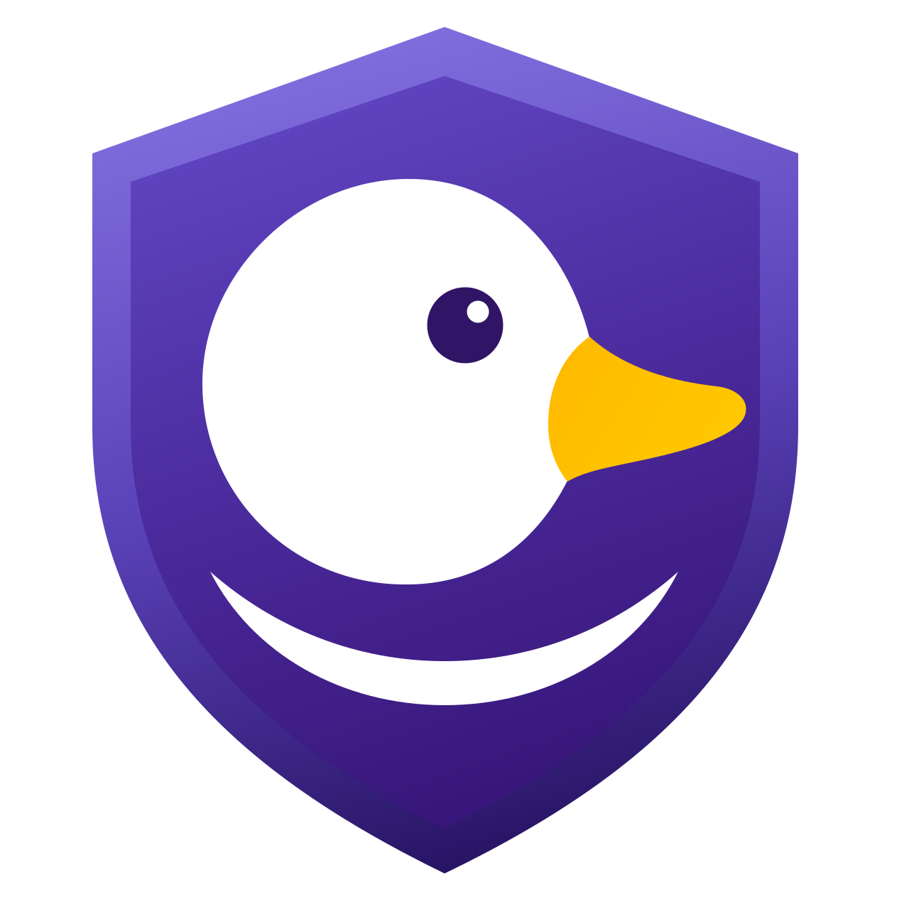

**English** | [Polski](README.pl.md)

<p align="center">
  
</p>

# InDuckGo

**A privacy-first web browser for Linux.** It rebuilds the protections of the open-source DuckDuckGo macOS
browser on top of **WebKitGTK 6.0** (the Linux port of the same WebKit engine Safari and the DuckDuckGo macOS
app use), with a **GTK 4 + libadwaita** user interface written in **Rust**. No telemetry, no extensions to
manage, and every profile and installed web app kept apart from the others.

[](https://github.com/eshaiotic/induckgo/actions/workflows/tests.yml)
[](https://github.com/eshaiotic/induckgo/releases/latest)


[](LICENSE)

InDuckGo is an independent project. It is not affiliated with or endorsed by Duck Duck Go, Inc.

---

## Measured against Chrome and Brave

Fresh profiles of all three browsers ran at the same time on 2026-11-02, behind a proxy that recorded only
host names. Trackers were judged by a neutral list (Disconnect's), each server counted once per site.

| | Chrome | Brave | InDuckGo |
|---|---|---|---|
| Trackers let through on 12 popular sites | 94 | 5 | **2** |
| … of which ad servers | 75 | 4 | **1** |
| Connections in 5 minutes of doing nothing | 46 to 15 hosts | 43 to 12 hosts | **20 to 8 hosts** |
| Fingerprint seen by sites | the same everywhere | changes per site, kept across restarts | **changes per site and per session** |

InDuckGo's idle connections fetch its protection data (DuckDuckGo's tracker list and privacy configuration,
Guard's filter lists) and load the DuckDuckGo start page. The method, every host and the places where
InDuckGo is weaker (no Safe Browsing, a rare engine that makes its users stand out) are in the
[tracking comparison](docs/en/reports/tracking-comparison.md). A one-page summary for non-technical readers is
[tracking-summary.html](docs/en/reports/tracking-summary.html) (download it and open it in a browser).

### Compared with DuckDuckGo's own browser

DuckDuckGo makes no browser for Linux (only for macOS, Windows, iOS and Android), so it could not run in the
measurement above. The table sets InDuckGo against the DuckDuckGo browser for macOS, whose protections
InDuckGo ports, as DuckDuckGo documents it (November 2026). It compares features; nothing here was measured.

| | DuckDuckGo for macOS | InDuckGo |
|---|---|---|
| **Tracking scripts** | | |
| Third-party trackers | blocked by DuckDuckGo's tracker list | blocked by the same list |
| Ads and trackers beyond that list | not blocked; no ad filter lists | blocked by EasyList, EasyPrivacy, uBlock Origin's and other lists, on a site's own requests too |
| Microsoft's ad tracking (`bat.bing.com`) | allowed on an advertiser's site after a click on a DuckDuckGo search ad | blocked; there is no ad-click exception |
| Tracking parameters in links (`utm_*`, `fbclid`, ...) | removed from the first navigation only | removed from every top-level navigation |
| Google AMP pages | replaced by the publisher's own page | left as they are |
| Cookie notices | answered with "reject" | hidden by a filter list, not answered |
| **Anonymity** | | |
| Fingerprinting defences (canvas, audio, battery, screen, referrer) | off in DuckDuckGo's macOS configuration | on: the fingerprint changes per site and per session |
| How common the browser looks | WebKit on macOS, the engine every Safari user has | WebKitGTK on Linux: few users, so InDuckGo stands out |
| Global Privacy Control | in JavaScript to every site; the `Sec-GPC` header only to sites known to honour it | in JavaScript and as the `Sec-GPC: 1` header to every site |
| HTTPS | the sites on DuckDuckGo's upgrade list | every navigation; asks before loading a site without HTTPS |
| Usage data sent to its maker | anonymous usage metrics to DuckDuckGo | none |
| **Hiding who you are** | | |
| Separate identities | Fire Windows: an isolated window whose data is deleted when it closes | profiles and web apps, each its own process with its own cookies and storage |
| Email address | Email Protection: free `@duck.com` addresses that forward mail with trackers removed | none |
| IP address | a VPN in DuckDuckGo's paid subscription | none built in |
| Scam and phishing sites | Scam Blocker: a list from Netcraft, checked on the device | none |

In short: InDuckGo blocks more and gives sites less to recognise it by, but its rare engine makes it stand out.
DuckDuckGo hides more of who you are (email address, IP address with the subscription), warns about scam sites,
and blends into Safari's crowd. Sources: DuckDuckGo's help pages on
[web tracking protections](https://duckduckgo.com/duckduckgo-help-pages/privacy/web-tracking-protections),
[Fire Windows](https://duckduckgo.com/duckduckgo-help-pages/privacy/fire-tabs),
[Email Protection](https://duckduckgo.com/duckduckgo-help-pages/email-protection/what-is-duckduckgo-email-protection),
[Scam Blocker](https://duckduckgo.com/duckduckgo-help-pages/threat-protection/scam-blocker) and
[anonymous metrics](https://duckduckgo.com/duckduckgo-help-pages/privacy/atb), and its privacy configuration
for macOS, which InDuckGo downloads.

---

## What it protects you from

| Protection | How it works |
|---|---|
| Third-party trackers | DuckDuckGo's Tracker Data Set is translated into WebKit content-blocking rules (port of `TrackerRadarKit`). |
| Breakage | DuckDuckGo's privacy configuration supplies per-site exceptions so sites keep working; the shield button (in a web app: *Protect This Site* in its menu) switches protection off for one site. |
| Fingerprinting, GPC | DuckDuckGo Content Scope Scripts run in every frame; InDuckGo Guard switches on the canvas, audio, screen and referrer defences DuckDuckGo leaves off, and sends the `Sec-GPC: 1` header. |
| Ads, trackers, cookie notices | InDuckGo Guard downloads EasyList, EasyPrivacy, uBlock Origin's, Peter Lowe's, Polish and cookie-notice filter lists and applies them to a site's own requests too. |
| Cross-site cookies | Third-party cookies are refused; WebKit Intelligent Tracking Prevention is on. |
| Tracking links | A navigation carrying `utm_*`, `fbclid`, `gclid`, ... is stopped before it leaves the machine and reloaded without them. |
| Plain HTTP | Navigations are upgraded to HTTPS; if a site has no HTTPS, a banner asks before loading it insecurely. |
| Leftover data | The Fire button erases the profile's cookies, storage, cache and favicons in one click. |
| Mixing identities | Every profile and every installed web app runs as its own process with its own cookies and storage. |

There is no extension support — by design, and because WebKitGTK has no extension API.

**Web apps.** *Install Site as App* (the button at the right end of the address bar, or the window menu)
turns any site — your bank, your mailbox — into a desktop application with the site's icon. Each app has
its own isolated session; a link you click inside it to another site opens in the browser, so the app's
login never meets foreign pages.

---

## Status

Usable work in progress: browsing with tabs, all protections above, profiles, web apps, downloads,
permission prompts and find-in-page work. Not built yet: session restore, bookmarks, history window,
cookie-consent handling, translations. The full list with reasons is in the architecture document.

In the future InDuckGo will ship as part of a new Linux distribution. It stays a standalone project and keeps
its packages for other distributions.

---

## Installing

Download a package from the [latest release](https://github.com/eshaiotic/induckgo/releases/latest):

| File | For |
|---|---|
| `induckgo_*_amd64.deb` | Debian 13, Ubuntu 24.04 LTS and newer |
| `induckgo-*.fc44.x86_64.rpm` | Fedora 44 |
| `induckgo-*-x86_64.pkg.tar.zst` | Arch Linux, CachyOS, EndeavourOS, Manjaro |
| `InDuckGo-*-x86_64.AppImage` | any other distribution with WebKitGTK 6.0, GTK ≥ 4.14 and libadwaita ≥ 1.5 |

Every release carries `SHA256SUMS` and a build provenance attestation, which proves the file was built by
this repository's GitHub Actions:

```sh
sha256sum --check --ignore-missing SHA256SUMS
gh attestation verify induckgo_*_amd64.deb --repo eshaiotic/induckgo
```

The packages use the system's WebKitGTK, GTK and libadwaita, so the browser engine keeps receiving your
distribution's security updates. The AppImage needs no installation:
`chmod +x InDuckGo-*-x86_64.AppImage && ./InDuckGo-*-x86_64.AppImage`.

From a checkout of this repository:

```sh
./install                 # Arch: builds the pacman package and installs it; Debian/Ubuntu/Fedora: installs dist/
./uninstall               # removes the package; profiles and web apps are kept
./uninstall --purge       # also deletes all InDuckGo data and web app launchers
```

---

## Building release packages

```sh
packaging/release.sh                # all formats into dist/, with SHA256SUMS
packaging/release.sh deb appimage   # or only some: arch, deb, appimage, rpm
```

The `.deb` and the AppImage are built in a Debian 13 container and the `.rpm` in a Fedora 44 container
(rootless podman), so they link against the libraries of the systems they target. The Arch package is
built on the host with `makepkg` and its `makepkg.conf` flags. The AppImage runtime is pinned to a release
and checked against its SHA-256.

Pushing a version tag publishes a release: `git tag vX.Y.Z && git push origin vX.Y.Z`. The
[release workflow](.github/workflows/release.yml) runs the same scripts (the Arch package in an Arch Linux
container), refuses dependencies with known vulnerabilities (`cargo audit`), and uploads the four packages
with `SHA256SUMS` and their attestations. The tag must match the version in `Cargo.toml`.

---

## Running from source

```sh
sudo pacman -S --needed rust webkitgtk-6.0 gtk4 libadwaita
cargo run -p induckgo                          # browser, default profile
cargo run -p induckgo -- --profile work        # browser, profile "work"
cargo run -p induckgo -- https://example.com/  # open a page
```

Installed web apps start from the desktop's application menu (`induckgo --web-app <id>`).

---

## Testing

Stack: **cargo-nextest** — 365 object-oriented Given/When/Then scenarios: 304 for the domain in
`crates/induckgo-core/tests/` (33 files, one per domain type) and 61 for the report tool in
`crates/induckgo-test-report/tests/`.

```sh
./run-tests                     # all tests + HTML report in tests/reports/ (opens in the browser)
cargo test -p induckgo-core     # domain tests only (fast, no GTK or WebKit needed)
cargo clippy --all-targets      # lints (pedantic, unsafe code forbidden)
cargo fmt --check               # formatting
cargo audit                     # dependency vulnerabilities (zero-vulnerability policy)
```

**Test report:** `./run-tests` always writes `tests/reports/test-report-YYYYMMDD-HHmm.html` — a run-history
dashboard with the latest run, the last 20 runs, failure rankings, features and the slowest tests, plus
`induckgo-core`'s coverage when `cargo-llvm-cov` is installed. See [HTML test report](docs/en/tests/test-report.md).

**Test architecture:**
- The domain (`induckgo-core`) has no GTK or WebKit dependency, so every protection decision — rule
  building, filter list conversion, HTTPS upgrade, link cleaning, profiles, web apps, zoom — is tested
  without a display.
- Each scenario is an object: `given_…` builds it, `when_…` acts and returns an outcome, `then_…` asserts
  one thing, following [Object Oriented Programming First](docs/en/engineering-rules.md):
  `LinkCleaningScenario::given_tracking_parameters_protection().when_link_is_opened(url).then_opens_unchanged()`.
- A failing test is retried once: one that then passes is reported as FLAKY, a defect to fix, never ignored.
- The [tests workflow](.github/workflows/tests.yml) runs fmt, clippy, `cargo audit` and `./run-tests` on
  every push to `main` and on every pull request, and keeps each run's report as an artifact.

---

## Project structure

```
crates/induckgo-core/    domain logic without GTK/WebKit: protection rules, Guard filter lists,
                         profiles, web apps, zoom, launch
crates/induckgo-core/tests/
                         one OO scenario file per domain type
crates/induckgo/         GTK 4 + libadwaita app: adapters that carry out core decisions in
                         WebKitGTK, libsoup and GIO
crates/induckgo-test-report/
                         developer tool behind ./run-tests: the HTML test report (never packaged)
assets/                  vendored Content Scope Scripts (Apache-2.0), Guard's page script, icons,
                         error page template; never the Tracker Data Set or filter lists
packaging/               PKGBUILD, rpm spec, deb/AppImage assembly, desktop entry, AppStream metadata
docs/en, docs/pl         architecture, engineering rules and reports (English canonical, Polish mirror)
```

- [Architecture](docs/en/architecture/overview.md) — processes, isolation, the protection pipeline, web apps, limitations.
- [Engineering rules](docs/en/engineering-rules.md) — Object Oriented Programming First, OO Given/When/Then tests.

---

## Licence

InDuckGo is free software under the [GNU General Public License, version 3 or later](LICENSE)
(`GPL-3.0-or-later`). Attributions are in [NOTICE](NOTICE).

### Licences of third-party data

- Content Scope Scripts 20.0.0 — Apache-2.0, vendored in `assets/content-scope-scripts` with its licence.
- Privacy configuration — Apache-2.0, downloaded at runtime.
- Tracker Data Set — **CC BY-NC-SA 4.0** (non-commercial), downloaded at runtime, never committed.
- InDuckGo Guard's filter lists — GPL-3.0, CC BY-SA 3.0, CC BY 3.0, CC BY-NC-SA 4.0 or their publisher's terms,
  downloaded at runtime, never committed.
- adblock-rust 0.13.5 — MPL-2.0, compiled in unmodified (source: <https://github.com/brave/adblock-rust>).
