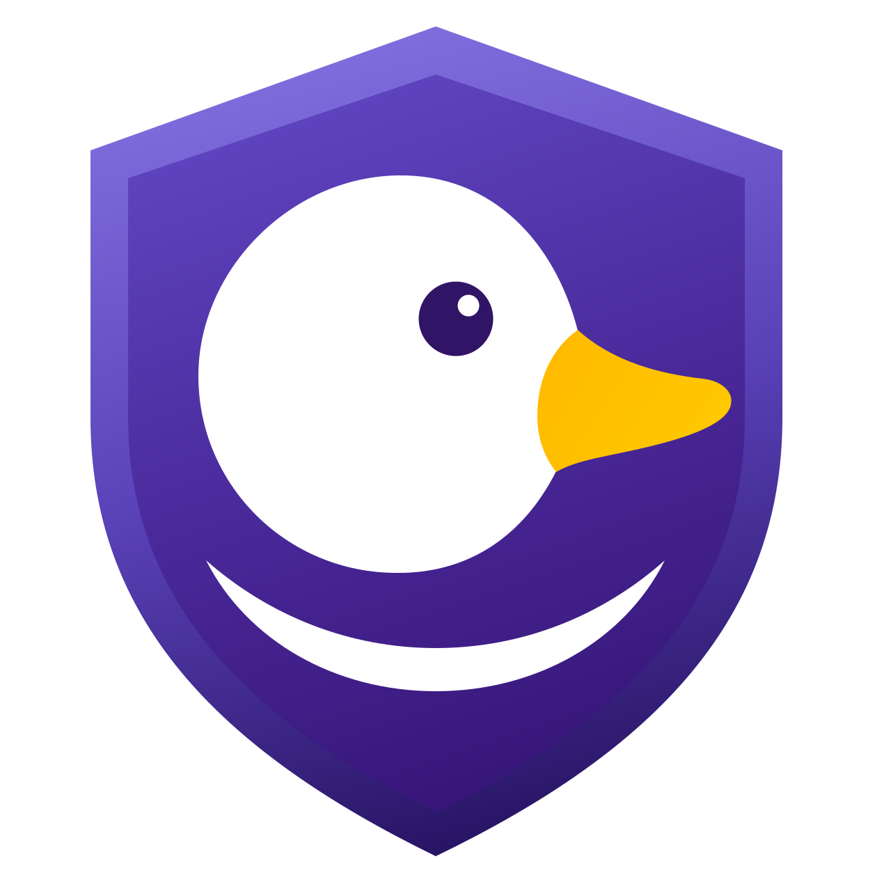

[English](README.md) | **Polski**

<p align="center">
  
</p>

# InDuckGo

**Przeglądarka dla Linuksa, w której prywatność jest na pierwszym miejscu.** Odtwarza ochronę z otwartej
przeglądarki DuckDuckGo dla macOS na silniku **QtWebEngine** (Chromium, silnik Chrome i Brave), z interfejsem
**Qt 6 Quick** i rdzeniem domenowym napisanym w **Rust**. Bez telemetrii, bez rozszerzeń do pilnowania, każdy
profil i każda zainstalowana aplikacja webowa są od siebie odizolowane. Pierwsza generacja działała na WebKitGTK (wersje przed 1.2.0);
jej kod zostaje w tym repozytorium, dopóki edycja Qt nie ma wszystkiego, co miała tamta (zob. *Status*).

[](https://github.com/eshaiotic/induckgo/actions/workflows/tests.yml)
[](https://github.com/eshaiotic/induckgo/releases/latest)


[](LICENSE)

InDuckGo to niezależny projekt. Nie jest powiązany z Duck Duck Go, Inc. ani przez nią wspierany.

---

## Zmierzone wobec Chrome i Brave, porównane z DuckDuckGo

2026-11-05 świeże profile Google Chrome 157, Brave 1.98 (Chromium 156) i InDuckGo działały jednocześnie, każdy
we własnym oknie, za proxy zapisującym wyłącznie nazwy hostów: 5 minut bezczynności, potem po 20 sekund na każdym
z 12 popularnych serwisów. Trackery ocenia neutralna lista (Disconnect), każdy serwer liczony raz na serwis.
Pomiar wykonano dwa razy (Chrome i Brave w obu, więc dwa przebiegi pokazują, jak bardzo wynik waha się między
uruchomieniami). Dwie kolumny Qt zmierzono ponownie tego samego dnia, tym samym zestawem, po pracach opisanych w
[Ochronie przed trackerami w edycji Qt](docs/pl/architecture/qt-protection.md); pozostałe kolumny pochodzą z
wcześniejszego przebiegu.

| | Chrome | Brave | InDuckGo Qt, świeży profil | InDuckGo Qt, dane ochrony na dysku | InDuckGo GTK (wersje przed 1.2.0) |
|---|---|---|---|---|---|
| Trackery przepuszczone na 12 serwisach | 111 / 109 | 9 / 8 | **5** | **5** | 6 |
| … w tym serwery reklam | 90 / 88 | 7 / 7 | **5** | **5** | 5 |
| Połączenia w pierwszych 5 minutach | 35 / 36 do 14 hostów | 47 / 53 do 12 hostów | 13 do 8 hostów | 13 do 8 hostów | 27 do 8 hostów |

Dwie liczby w komórkach Chrome i Brave to pierwszy i drugi przebieg.

**Jak to czytać.** Edycja Qt, na której InDuckGo jest teraz zbudowany, przepuszcza najmniej trackerów z pięciu
kolumn, zarówno na świeżym profilu, jak i z danymi ochrony już na dysku: 5 na 12 serwisach, wobec 6 w zastępowanej
edycji WebKitGTK, 8 lub 9 w Brave i 109 lub 111 w Chrome. Strony nadal się wczytują (allegro.pl i forbes.com, które
zepsuła pierwsza, grubsza wersja, działają). Osiąga to dzięki własnym regułom DuckDuckGo ocenianym tak, jak ocenia je
DuckDuckGo, ostrzejszej warstwie dla trackerów reklamowych i analitycznych, lokalnej bramce, która odrzuca połączenia
otwierane przez stronę, zanim wyśle jakiekolwiek żądanie (`preconnect`, którego filtry żądań nie widzą), oraz
pobieraniu reguł przy pierwszym uruchomieniu. Pięć, które zostają, to okno logowania Google (`accounts.google.com`,
`www.google.com`) i `m.stripe.network`, które DuckDuckGo dopuszcza, bo ich zablokowanie psuje logowanie i płatności.
Koszt pobierania widać w ruchu bezczynności: edycja Qt łączyła się ze stroną startową DuckDuckGo, jej hostem pingu
i sześcioma hostami serwującymi dane ochrony (13 połączeń z 8 hostami); Chrome z Google, a Brave z własnymi serwerami
(ping użycia, P3A). 27 połączeń edycji GTK to jej pierwsze pobrania. Odcisku przeglądarki nie zmierzono ponownie:
edycja Qt nie ma jeszcze ochrony przed fingerprintingiem, a wynik edycji GTK (szum inny na każdym serwisie i w
każdej sesji, pomiar z 2026-11-02) jest w [porównaniu śledzenia](docs/pl/reports/tracking-comparison.md). Chrome 157
i Brave 1.98 to różne wersje Chromium, 157 i 156. Jedno uruchomienie z jednego kraju w jednej sieci to nie ranking,
a 5 wobec 6 mieści się w tym, czym różnią się dwa przebiegi tej samej przeglądarki; metoda i ograniczenia są
w raporcie.

[tracking-summary.html](docs/pl/reports/tracking-summary.html) to jednostronicowe podsumowanie dla osób spoza
branży (pobierz i otwórz w przeglądarce).

### Porównanie z przeglądarką DuckDuckGo

DuckDuckGo nie wydaje przeglądarki na Linuksa (tylko Windows, macOS, iOS i Androida), więc jej przeglądarki **nie
mierzono**. Tabela zestawia InDuckGo z tym, co DuckDuckGo mówi o własnej przeglądarce, w liście funkcji ze
[strony porównania](https://duckduckgo.com/compare-privacy) („See how DuckDuckGo compares”) i na
[stronie pomocy o ochronie przed śledzeniem](https://duckduckgo.com/duckduckgo-help-pages/privacy/web-tracking-protections),
obie czytane w listopadzie 2026. Kolumna DuckDuckGo to jego własne twierdzenia, dla aplikacji na Windows i macOS
(gdzie się różnią, nazwano macOS); kolumna InDuckGo to to, co edycja Qt robi dziś, sprawdzone w kodzie.
Niezależne liczby o przeglądarce DuckDuckGo są na [privacytests.org](https://privacytests.org/), które testuje
DuckDuckGo, Brave i Chrome na komputerach i nie testuje InDuckGo.

| | Przeglądarka DuckDuckGo mówi | InDuckGo (Qt) dziś |
|---|---|---|
| **Skrypty śledzące** | | |
| Blokuje trackery stron trzecich, zanim się wczytają | tak, według swojej listy trackerów | tak, według tej samej listy i list filtrów Guarda, także w żądaniach do domeny samego serwisu; reguły są pobierane przy pierwszym uruchomieniu i odświeżane (okno raz na nie czeka) |
| Blokuje ciasteczka trackerów stron trzecich | tak | ciasteczka z listy trackerów są odrzucane; profil *Strict* (jeszcze bez interfejsu) odrzuca wszystkie |
| Wygasza ciasteczka własne | macOS: po 24 godzinach lub 7 dniach; Windows: w planach | nie |
| Chroni przed odciskiem przeglądarki | listowane skrypty blokowane, listowane API nadpisywane; obrona canvas i audio wyłączona na macOS | **jeszcze nie** w edycji Qt (edycja GTK to miała, z szumem na serwis i sesję) |
| Chroni przed maskowaniem CNAME | podzbiór swojej listy na macOS | według nazw hostów zamaskowanych trackerów z listy |
| Chroni przed śledzeniem przez referer | referer skracany do nazwy hosta | tylko domyślne ustawienie Chromium |
| Blokuje śledzenie w linkach | tylko pierwsza nawigacja na macOS; Windows: w planach | każda nawigacja najwyższego poziomu |
| Blokuje śledzenie Google AMP | macOS: linki AMP zastępowane | nie |
| Blokuje wyskakujące okna logowania Google | tak | nie |
| Blokuje osadzone treści Facebooka | tak | Facebook jest na liście trackerów; brak zastępnika „kliknij, by wczytać” |
| **Reklamy i wyskakujące okna** | | |
| Blokuje okna zgody na cookies | zamyka okna z listy, wybierając opcję prywatną | ukrywa je listą filtrów, nie odpowiada na nie; **automatyczne odrzucanie to następna funkcja** |
| Blokuje reklamy ukierunkowane i nieśledzące | mówi, że próbuje blokować wszystkie reklamy, z udokumentowanym wyjątkiem Microsoftu: `bat.bing.com` ładuje się na stronie reklamodawcy po kliknięciu reklamy w wyszukiwarce DuckDuckGo | listy filtrów Guarda (EasyList, uBlock Origin i inne), bez wyjątku dla kliknięć w reklamy |
| Odtwarza YouTube bez reklam | tak (Duck Player) | nie |
| **Kontrola** | | |
| Global Privacy Control | tak (macOS: nagłówek tylko do serwisów, o których wiadomo, że go respektują) | **jeszcze nie** w edycji Qt (edycja GTK wysyłała go do każdego serwisu) |
| Usuwa dane przeglądania jednym przyciskiem | przycisk Fire | przycisk Wymaż dane przeglądania |
| Podnosi do HTTPS | serwisy z jego listy (około 90 % kliknięć w wyszukiwarce) | każda nawigacja, poza serwisami wyłączonymi w konfiguracji DuckDuckGo |
| Szyfruje zapytania DNS | tak | jeszcze nie (bezpieczny DNS Chromium nie jest skonfigurowany) |
| Przechowuje hasła lokalnie, synchronizuje prywatnie | tak | nie |
| Dane o użyciu wysyłane do twórcy | anonimowe metryki użycia | brak |
| **Poza przeglądarką** | | |
| Prywatne wyszukiwanie domyślnie | tak | DuckDuckGo jest domyślną wyszukiwarką |
| Ochrona przed oszustwami i phishingiem | Scam Blocker, lista Netcraft sprawdzana na urządzeniu | nie |
| Ochrona poczty | darmowe aliasy `@duck.com`, wymaga rejestracji | nie |
| VPN | w płatnej subskrypcji | jeszcze nie w edycji Qt; edycja GTK ma okno Tor |
| Usuwa dane osobowe z serwisów brokerów danych, pomaga odzyskać tożsamość | w płatnej subskrypcji (usługa tożsamości dla mieszkańców USA) | nie; zaplanowane, zob. *Następne wydanie* niżej |
| Działa na Linuksie | nie | tak |

W skrócie: przeglądarka DuckDuckGo wygrywa dziś gotowymi ochronami, a InDuckGo tym, czego nie zrobi (telemetria,
wyjątki dla kliknięć w reklamy, płatne poziomy) i działaniem na Linuksie; luka w gotowych ochronach to praca, która
stoi przed tym projektem, a nie coś, co powyższe liczby ukrywają.

---

## Przed czym chroni

Silnikiem InDuckGo jest teraz **QtWebEngine** (Chromium), a interfejs jest w Qt Quick. Poniższe zabezpieczenia
zbudowano dla edycji WebKitGTK; ostatnia kolumna mówi, jak daleko ma je edycja Qt.

| Ochrona | Jak działa | W edycji Qt |
|---|---|---|
| Trackery stron trzecich | Tracker Data Set DuckDuckGo rozstrzyga, żądanie po żądaniu, które żądania stron trzecich są odrzucane (port `TrackerRadarKit`). | działa; pobierane przy pierwszym uruchomieniu, odświeżane co 6 godzin |
| Psucie stron | Konfiguracja prywatności DuckDuckGo dostarcza wyjątki dla serwisów, żeby działały; przycisk tarczy (w aplikacji webowej: *Chroń tę witrynę* w menu) wyłącza ochronę dla jednego serwisu. | działa |
| Fingerprinting, GPC | Content Scope Scripts DuckDuckGo działają w każdej ramce; InDuckGo Guard włącza obronę canvas, audio, ekranu i referera, którą DuckDuckGo zostawia wyłączoną, i wysyła nagłówek `Sec-GPC: 1`. | jeszcze nie |
| Reklamy, trackery, komunikaty o cookies | InDuckGo Guard pobiera listy EasyList, EasyPrivacy, uBlock Origin, Petera Lowe'a, polskie i listy komunikatów o cookies, i stosuje je także do własnych zapytań serwisu. | działa; pobierane razem z resztą danych |
| Ciasteczka między serwisami | Ciasteczka stron trzecich z listy trackerów są odrzucane; profil *Strict*, który odrzuca wszystkie, istnieje w kodzie, ale nie ma jeszcze interfejsu. | działa |
| Linki śledzące | Nawigacja z `utm_*`, `fbclid`, `gclid`, ... jest zatrzymywana, zanim opuści komputer, i ładowana od nowa bez nich. | działa |
| Zwykłe HTTP | Nawigacje są podnoszone do HTTPS. | działa |
| Pozostawione dane | Przycisk Wymaż dane przeglądania jednym kliknięciem kasuje ciasteczka, magazyn, pamięć podręczną i favikony profilu. | działa |
| Mieszanie tożsamości | Każdy profil i każda zainstalowana aplikacja webowa działa jako osobny proces z własnymi ciasteczkami i danymi. | działa |
| Twój adres IP | Okno Tor wysyła wszystko przez własnego Tora InDuckGo; jego sesja żyje tylko w pamięci. | jeszcze nie (ma je edycja GTK) |

Rozszerzeń nie ma — celowo.

**Aplikacje webowe.** *Zainstaluj witrynę jako aplikację* (przycisk na prawym końcu paska adresu albo menu okna) zamienia
dowolny serwis — bank, pocztę — w aplikację na pulpicie z ikoną serwisu. Każda aplikacja ma własną,
odizolowaną sesję; link do innego serwisu kliknięty w aplikacji otwiera się w przeglądarce, więc logowanie
aplikacji nigdy nie spotyka obcych stron. *Zainstalowane aplikacje…* w menu pokazuje je jako kafelki z przyciskami
Otwórz i Odinstaluj.

**Okno Tor (edycja GTK; w drodze do edycji Qt).** Przycisk z cebulą na pasku narzędzi, *Nowe okno Tor*
(`Alt+Shift+N`) albo `induckgo --tor` otwiera okno, którego każde żądanie idzie przez Tora, więc serwisy widzą
przekaźnik wyjściowy Tora zamiast Twojego adresu. InDuckGo uruchamia dla niego własny `tor`, nigdy ogólnosystemową
usługę Tor, i pokazuje postęp łączenia, aż Tor będzie gotowy; do tego czasu żadna strona się nie wczytuje i nic
nigdy nie przechodzi na połączenie bezpośrednie. Ciasteczka, pamięć podręczna i ustawienia okna żyją tylko w
pamięci, WebRTC jest wyłączone, wyszukiwanie idzie przez usługę onion DuckDuckGo, a strony `.onion` się otwierają.
Tam, gdzie Tor jest blokowany, *Połączenie z Tor…* oferuje Snowflake, obfs4 albo własne mosty. Okno ukrywa Twój
adres, ale nie to, że używasz InDuckGo: gdy liczy się nieodróżnialność wśród użytkowników Tora, używaj Tor Browsera.

**Preferencje** (`Ctrl+,`), osobno w każdym profilu: które przyciski pokazuje pasek narzędzi, czy pasek adresu
jest szeroki, czy krótki i wyśrodkowany, **gdzie są karty** (*Położenie kart*: góra, dół, lewo lub prawo; domyślnie
góra), **jak wyglądają przyciski okna** (*Przyciski okna*: domyślne okrągłe po prawej albo trzy kolorowe kropki po
lewej jak w macOS), płynne przewijanie kółkiem, folder pobierania i język interfejsu (68 języków).

---

## Jak wycinamy śledzenie i co to potwierdza

Strona, reklamodawca albo sam producent przeglądarki mogą Cię śledzić na siedem sposobów. Tabela nazywa każdy
z nich, mechanizm użyty przeciwko niemu przez InDuckGo, miejsce tego mechanizmu w kodzie i test lub pomiar,
który go sprawdza. Decyzje mieszkają w niezależnej od silnika bibliotece domenowej, więc współdzielą je edycja
WebKitGTK i edycja Qt; czego edycji Qt jeszcze brakuje, wymienia [tabela ochron](#przed-czym-chroni) wyżej i
[plan migracji](docs/pl/plans/2026-11-04-qtwebengine-migration-plan.md).

| Sposób śledzenia | Co robi InDuckGo | Kod (`crates/induckgo-core/src`) | Sprawdza to |
|---|---|---|---|
| Przeglądarka raportuje do producenta | W ogóle nie ma kodu telemetrii: żadnego pingu użycia, raportów awarii, ziarna eksperymentów ani konta. Jedyne połączenia, jakie program sam nawiązuje, to zwykłe `GET` po dane ochronne, bez ciasteczek i bez identyfikatora. | `protection/`, `guard/` (tylko pobieranie) | Ruch bezczynności zmierzony na poziomie nazw hostów: edycja Qt łączy się z 8 hostami: stroną startową DuckDuckGo, jej hostem pingu i sześcioma serwującymi dane ochrony ([raport §4.1](docs/pl/reports/tracking-comparison.md) dla edycji GTK) |
| Trackery stron trzecich | Tracker Data Set DuckDuckGo rozstrzyga każde żądanie (reguły blokowania treści WebKit w edycji GTK, przechwytywacz żądań w edycji Qt oraz lokalna bramka połączeń odrzucająca podpowiedzi `preconnect`), razem z wyjątkami DuckDuckGo dla poszczególnych witryn, by strony działały. Edycja Qt dodaje ostrzejszą warstwę dla trackerów reklamowych i analitycznych. | `protection/tracker_data_set.rs`, `protection/content_blocker_rules_builder.rs`, `network/content_blocker_request_policy.rs`, `network/advertising_tracker_request_policy.rs`, `network/connection_gate.rs` | Testy scenariuszowe `tracker_data_set`, `content_blocker_rules_builder`, `content_blocker_request_policy`, `advertising_tracker_request_policy`, `connection_gate`, `rule_exceptions`; Qt: `gate_proxy`, `tracker_blocking` ([architektura](docs/pl/architecture/qt-protection.md)) |
| Reklamy i trackery, których pierwsza lista nie zna | Guard pobiera dziewięć list społeczności (EasyList, EasyPrivacy, uBlock Origin, Petera Lowe'a, polskie i listy komunikatów o ciasteczkach), kompiluje je i stosuje także do żądań własnej witryny. Komunikaty o ciasteczkach są ukrywane. | `guard/guard_engine.rs`, `guard/guard_rule_list.rs`, `network/guard_request_policy.rs` | Testy `guard_engine`, `guard_rule_list`, `guard_request_policy`; edycja GTK: 6 trackerów na 12 stronach wobec 109 w Chrome (wyżej) |
| Ciasteczka i zapisane identyfikatory | Ciasteczka stron trzecich z listy trackerów są odrzucane (edycja GTK miała też Intelligent Tracking Prevention z WebKit), każdy profil i aplikacja internetowa to osobny proces z własnym magazynem, a Wymaż dane przeglądania kasuje profil jednym kliknięciem. | `storage/cookie_policy.rs`, `storage/tracker_cookie_policy.rs`, `storage/burn_planner.rs` | Testy `cookie_policies`, `burn_planner` |
| Identyfikatory w linkach | `utm_*`, `fbclid`, `gclid` i inne parametry z listy DuckDuckGo są usuwane z każdej nawigacji najwyższego poziomu, zanim żądanie opuści komputer. | `protection/tracking_parameter_remover.rs`, `network/link_cleaning_request_policy.rs` | Testy `tracking_parameter_remover`, `link_cleaning_request_policy` |
| Odciski przeglądarki | Content Scope Scripts DuckDuckGo działają w każdej ramce, a Guard włącza zabezpieczenia canvas, dźwięku, ekranu i referera, które konfiguracja DuckDuckGo na macOS zostawia wyłączone. Szum zmienia się z witryną i z sesją. | `guard/fingerprint_hardening.rs`, `protection/content_scope_script.rs` | Testy `fingerprint_hardening`, `content_scope_script`; strona próbkująca w raporcie (§4.3) |
| Co widzi sieć i serwer strony | Nawigacje są podnoszone do HTTPS, a baner pyta, zanim wczyta się strona bez HTTPS; `Sec-GPC: 1` trafia do każdej witryny. Dla adresu IP okno Tor kieruje wszystko przez własny Tor InDuckGo, nigdy nie wraca do połączenia bezpośredniego, nic nie zapisuje na dysku, wyłącza WebRTC i prosi o angielski jak Tor Browser. | `navigation/https_upgrade_policy.rs`, `network/https_upgrade_request_policy.rs`, `tor/` | Testy `https_upgrade_policy`, `https_upgrade_request_policy`, `tor_configuration`, `tor_endpoint`; [architektura §4.1](docs/pl/architecture/overview.md) |

Każda lista i zestaw danych jest pobierany, nigdy dołączany, a przed użyciem ograniczany rozmiarem i
walidowany. Lista filtrów może tylko blokować albo ukrywać: konwersja nie zachowuje skryptletów, więc złośliwa
lista mogłaby zepsuć stronę, ale nigdy nie uruchomi w niej kodu. Cały zestaw (`./run-tests`, 886 testów razem z testami Qt, oraz
clippy i `cargo audit` w CI) uruchamia się przy każdym wypchnięciu.

### Dowody

Pomiar stojący za [pierwszą tabelą](#zmierzone-wobec-chrome-i-brave-porównane-z-duckduckgo) uruchomił 2026-11-05
obok siebie Chrome 157, Brave 1.98 i InDuckGo, na świeżych profilach, każdy we własnym oknie, przez proxy
zapisujące wyłącznie nazwy hostów. Liczby, powtórzone tu obok mechanizmów:

- **Trackery osiągnięte na 12 stronach:** Chrome 111 i 109 w dwóch przebiegach, Brave 9 i 8, edycja Qt InDuckGo 90
  na świeżym profilu i 5 z danymi ochrony na dysku, jego edycja GTK 6, według listy Disconnect, której żadna z
  nich nie używa.
- **Wysłane do producenta w 5 minut bezczynności:** Chrome łączył się wyłącznie z Google (14 hostów), Brave
  głównie z własnymi serwerami (ping użycia, P3A), edycja Qt ze stroną startową DuckDuckGo, jej hostem
  pingu i sześcioma hostami serwującymi dane ochrony (8 hostów).
- **Odcisk przeglądarki (edycja GTK, 2026-11-02):** te same wartości canvas i dźwięku na każdej stronie w Chrome;
  różne dla witryn, ale takie same po restarcie w Brave; różne dla witryny *i* sesji w InDuckGo.
- **Metoda, ograniczenia i przepis na powtórzenie pomiaru:** [porównanie śledzenia](docs/pl/reports/tracking-comparison.md), §3 i §8.

### Czego to nie dowodzi

Pomiar potwierdza, że „InDuckGo nie daje własnemu producentowi nic do roboty, a gdy ma dane ochrony na miejscu,
daje trackerom niewiele”. Nie potwierdza, że „InDuckGo jest bardziej anonimowy niż Brave lub DuckDuckGo”, i projekt
tego nie twierdzi.

- **5 wobec 8 to przewaga na jednej próbce, nie prawo.** Edycja Qt blokuje tu mocniej niż Brave, bo stosuje ostrzejszą
  warstwę dla trackerów reklamowych i analitycznych oraz odrzuca `preconnect`; ta sama ostrość może zepsuć stronę,
  którą łagodniejsze tarcze Brave zostawiają działającą, a lekarstwem jest przełącznik tarczy dla witryny. Okna
  logowania i trackery płatności są celowo zostawione wyjątkom DuckDuckGo.
- **Jedno uruchomienie na 12 stronach to nie ranking.** Dwa przebiegi Chrome różnią się o 2, Brave o 1; strony
  zmieniają się między wczytaniami.
- **Przeglądarki DuckDuckGo nie zmierzono**, bo nie istnieje na Linuksa.
  [Tabela funkcji](#porównanie-z-przeglądarką-duckduckgo) porównuje udokumentowane zachowanie, nie ruch.
- **Blokowanie to nie anonimowość.** InDuckGo to silnik Chromium jak Brave i Chrome, co dobrze robi na wtapianie się
  w tłum, ale edycja Qt nie zmienia jeszcze tego, co serwis może odczytać o przeglądarce: brak szumu odcisku, brak
  GPC. Zainstalowane czcionki pozostają widoczne, tak jak w Brave i Chrome.
- **Brak ostrzeżeń przed phishingiem i złośliwym oprogramowaniem** (brak Safe Browsing), brak aliasów e-mail i
  VPN na razie. Okno Tor, gdy wróci do edycji Qt, ukrywa Twój adres, nie fakt używania InDuckGo; gdy liczy się
  nieodróżnialność, użyj Tor Browser.
- **Brakuje niezależnej weryfikacji:** [privacytests.org](https://privacytests.org/) nie testuje InDuckGo.

---

## Stan

Projekt w toku, ale używalny, na QtWebEngine: karty (u góry, na dole, z lewej lub z prawej), profile z odizolowanymi
danymi i kafelkowym oknem wyboru jak w Chrome, aplikacje webowe z kafelkową stroną, pobieranie do wybranego folderu, powiększenie osobno dla witryny,
wyszukiwanie na stronie, przełącznik ochrony dla witryny, Wymaż dane przeglądania, 68 języków interfejsu. Jeszcze
nie ma w edycji Qt: ochrony przed odciskiem przeglądarki i GPC, okna Tor, automatycznego odrzucania okien zgody na cookies, pytań o uprawnienia, przywracania sesji,
zakładek i historii. Pełna lista z uzasadnieniem jest w dokumencie architektury i w planie migracji.

### Następne wydanie

Zaplanowane, niezaczęte i do zaprojektowania przed budową: usuwanie Twoich danych osobowych z serwisów brokerów
danych, pomoc w odzyskaniu tożsamości, gdy zostanie skradziona, oraz VPN — wszystko za darmo. DuckDuckGo sprzedaje te
trzy rzeczy w płatnej subskrypcji; InDuckGo chce je dać bez opłat. Potrzebują serwerów lub partnerów i ustaleń
prawnych, więc nie ma daty. Wcześniej moduł okien zgody na cookies: wykrywacz, który budzi się po wczytaniu strony
i sam odrzuca prośbę o zgodę (na przykład Facebooka), gdy tarcza jest włączona.

W przyszłości InDuckGo będzie częścią nowej dystrybucji Linuksa. Pozostanie samodzielnym projektem i zachowa
paczki dla innych dystrybucji.

---

## Instalacja

Pobierz paczkę z [najnowszego wydania](https://github.com/eshaiotic/induckgo/releases/latest). Paczki wersji
1.2.2 i nowszych zawierają edycję Qt (QtWebEngine); wydania przed 1.2.0 zawierały edycję na WebKitGTK.

| Plik | Dla |
|---|---|
| `induckgo-*.fc44.x86_64.rpm` | Fedora 44 |
| `induckgo-*-x86_64.pkg.tar.zst` | Arch Linux, CachyOS, EndeavourOS, Manjaro |
| `InDuckGo-*-x86_64.AppImage` | każda inna dystrybucja z glibc 2.43 lub nowszą (około 230 MB: zawiera Chromium 140) |

Każde wydanie ma `SHA256SUMS` i atestację pochodzenia (build provenance), która dowodzi, że plik zbudował
GitHub Actions tego repozytorium:

```sh
sha256sum --check --ignore-missing SHA256SUMS
gh attestation verify InDuckGo-*-x86_64.AppImage --repo eshaiotic/induckgo
```

Paczki rpm i pacmana korzystają z systemowych Qt i QtWebEngine, więc silnik przeglądarki dostaje aktualizacje
bezpieczeństwa Twojej dystrybucji; zależą od pakietów Qt Quick, QtWebChannel, QtWebEngine i SVG, które menedżer
pakietów doinstaluje. AppImage niesie własne Qt i QtWebEngine (Chromium), grafikę bierze z hosta, a aktualizacje
silnika dostaje tylko z nowym wydaniem InDuckGo. Nie wymaga instalacji:
`chmod +x InDuckGo-*-x86_64.AppImage && ./InDuckGo-*-x86_64.AppImage`. Pulpity z Waylandem biorą ikonę okna z
zainstalowanego pliku `.desktop`, którego AppImage nie ma, więc przy starcie zapisuje go sobie sam
(`~/.local/share/applications/io.github.induckgo.InDuckGo.desktop` i ikonę obok, wskazujące plik AppImage; po
przeniesieniu pliku uruchom go jeszcze raz). Wpis menu uruchamia ten plik później, więc wskazuje prawdziwy plik
(po rozwiązaniu dowiązań) i powstaje tylko wtedy, gdy ten plik i każdy katalog nad nim, aż do Twojego katalogu
domowego, należą do roota lub do Ciebie, a grupa ani inni nie mogą do nich pisać (nic pod `/tmp` ani innym katalogiem
współdzielonym nie spełnia tego warunku). Wpis znika, gdy jego plik przestaje spełniać warunek. Wpisu napisanego przez
Ciebie nigdy nie ruszamy (wygenerowany ma `X-InDuckGo-AppImage=<path>`), a przy zainstalowanej paczce nic nie powstaje. Edycja Qt nie ma jeszcze okna
Tor, więc żadna paczka nie dociąga Tora.

Z kopii tego repozytorium:

```sh
./install                 # Arch: buduje paczkę pacmana i ją instaluje; Fedora: instaluje dist/
./uninstall               # usuwa paczkę; profile i aplikacje webowe zostają
./uninstall --purge       # kasuje też wszystkie dane InDuckGo i skróty aplikacji webowych
```

---

## Budowanie paczek wydania

```sh
packaging/release.sh                # wszystkie formaty do dist/, z SHA256SUMS
packaging/release.sh appimage rpm   # albo tylko wybrane: arch, appimage, rpm
```

AppImage i `.rpm` powstają w kontenerze Fedory 44 (rootless podman albo `CONTAINER_ENGINE=docker`), więc linkują
się z bibliotekami systemów, na które są przeznaczone, i niosą albo używają Chromium 140. Nie ma `.deb`: Qt
WebEngine Debiana 13 (Qt 6.8, Chromium 122) jest starszy niż próg silnika InDuckGo, a żaden stabilny Debian ani
Ubuntu nie ma nowszego. Paczkę dla Archa buduje `makepkg` na hoście, z flagami jego `makepkg.conf` (bez
optymalizacji w czasie łączenia, której linker Rusta nie czyta w części C++). Runtime AppImage jest przypięty do
wydania i sprawdzany po SHA-256.

Wypchnięcie taga wersji publikuje wydanie: `git tag vX.Y.Z && git push origin vX.Y.Z`.
[Workflow wydania](.github/workflows/release.yml) uruchamia te same skrypty (paczkę Archa w kontenerze Arch
Linux), odrzuca zależności ze znanymi podatnościami (`cargo audit`) i wysyła cztery paczki z `SHA256SUMS` oraz
atestacjami. Tag musi zgadzać się z wersją w `Cargo.toml`.

---

## Uruchamianie ze źródeł

Edycja Qt potrzebuje Qt 6 z QtWebEngine, QtWebChannel i Quick Controls (na Archu: `qt6-base qt6-declarative
qt6-webengine qt6-webchannel qt6-svg`), kompilatora C++ i Rusta.

```sh
sudo pacman -S --needed rust qt6-base qt6-declarative qt6-webengine qt6-webchannel qt6-svg
cargo run --release -p induckgo-qt                          # przeglądarka, profil domyślny
cargo run --release -p induckgo-qt -- --profile work        # przeglądarka, profil "work"
cargo run --release -p induckgo-qt -- https://example.com/  # otwórz stronę
```

Poprzednia edycja nadal się buduje i działa: `sudo pacman -S --needed webkitgtk-6.0 gtk4 libadwaita tor`, potem
`cargo run -p induckgo` (ma też `--tor` dla okna Tor).

Zainstalowane aplikacje webowe uruchamia się z menu aplikacji pulpitu (`induckgo-qt --web-app <id>`).

---

## Testy

Stos: **cargo-nextest** — 886 obiektowych scenariuszy Given/When/Then: 676 dla domeny w
`crates/induckgo-core/tests/` (81 plików, jeden na typ domenowy), 140 dla edycji Qt i jej adaptera silnika, 61 dla
narzędzia raportu w `crates/induckgo-test-report/tests/` i 9 dla narzędzia benchmarków w
`crates/induckgo-bench/tests/`. CI uruchamia je wszystkie w kontenerze Arch z Qt 6, testy Qt pod Xvfb z Mesą (QtWebEngine potrzebuje kontekstu
OpenGL nawet bez okna); same testy Qt uruchom przez
`xvfb-run -a cargo test -p induckgo-qt -p induckgo-engine-qt` (albo `QT_QPA_PLATFORM=offscreen` na pulpicie).

```sh
./run-tests                     # wszystkie testy + raport HTML w tests/reports/ (otwiera się w przeglądarce)
cargo test -p induckgo-core     # tylko testy domeny (szybkie, bez Qt, GTK i WebKita)
cargo clippy --all-targets      # linty (pedantic, unsafe zabroniony)
cargo fmt --check               # formatowanie
cargo audit                     # podatności zależności (polityka zero podatności)
```

**Raport testów:** `./run-tests` zawsze zapisuje `tests/reports/test-report-YYYYMMDD-HHmm.html` — dashboard
historii przebiegów z ostatnim przebiegiem, ostatnimi 20 przebiegami, rankingami błędów, funkcjonalnościami i
najwolniejszymi testami, a gdy zainstalowany jest `cargo-llvm-cov`, także z pokryciem `induckgo-core`. Zobacz
[Raport testów HTML](docs/pl/tests/test-report.md).

**Architektura testów:**
- Domena (`induckgo-core`) nie zależy od Qt, GTK ani WebKita, więc każda decyzja ochrony — budowanie reguł,
  konwersja list filtrów, podnoszenie do HTTPS, czyszczenie linków, profile, aplikacje webowe, zoom — jest
  testowana bez ekranu.
- Każdy scenariusz to obiekt: `given_…` go buduje, `when_…` wykonuje akcję i zwraca wynik, `then_…` sprawdza
  jedną rzecz, zgodnie z [Object Oriented Programming First](docs/pl/engineering-rules.md):
  `LinkCleaningScenario::given_tracking_parameters_protection().when_link_is_opened(url).then_opens_unchanged()`.
- Nieudany test jest powtarzany raz: jeśli wtedy przejdzie, raport oznacza go jako FLAKY — to błąd do
  naprawy, nigdy do zignorowania.
- [Workflow testów](.github/workflows/tests.yml) uruchamia fmt, clippy, `cargo audit` i `./run-tests` przy
  każdym pushu do `main` i przy każdym pull requeście, i zachowuje raport każdego przebiegu jako artefakt.

---

## Struktura projektu

```
crates/induckgo-core/    logika domeny bez Qt/GTK/WebKita: reguły ochrony, listy filtrów Guarda,
                         profile, aplikacje webowe, zoom, uruchamianie, położenie kart i styl przycisków okna
crates/induckgo-core/tests/
                         jeden plik scenariuszy OO na typ domenowy
crates/induckgo-qt/      przeglądarka: interfejs Qt Quick (QML) na QtWebEngine, spięty z Rustem przez cxx-qt
crates/induckgo-engine-qt/
                         adapter QtWebEngine: polityki żądań i ciasteczek, przekładka w C++
crates/induckgo/         poprzednia edycja: GTK 4 + libadwaita na WebKitGTK (wersje przed 1.2.0)
crates/induckgo-test-report/
                         narzędzie deweloperskie za ./run-tests: raport testów HTML (nie trafia do paczek)
assets/                  dołączone Content Scope Scripts (Apache-2.0), skrypt strony Guarda, ikony,
                         szablon strony błędu; nigdy Tracker Data Set ani listy filtrów
packaging/               PKGBUILD, spec rpm, budowa i składanie AppImage, plik .desktop, metadane AppStream
docs/en, docs/pl         architektura, zasady inżynierskie i raporty (kanoniczny angielski, polskie lustro)
```

- [Architektura](docs/pl/architecture/overview.md) — procesy, izolacja, potok ochrony, aplikacje webowe, ograniczenia.
- [Zasady inżynierskie](docs/pl/engineering-rules.md) — Object Oriented Programming First, testy OO Given/When/Then.

---

## Licencja

InDuckGo to wolne oprogramowanie na licencji [GNU General Public License w wersji 3 lub późniejszej](LICENSE)
(`GPL-3.0-or-later`). Atrybucje są w [NOTICE](NOTICE).

### Licencje danych stron trzecich

- Content Scope Scripts 20.0.0 — Apache-2.0, dołączone w `assets/content-scope-scripts` razem z licencją.
- Konfiguracja prywatności — Apache-2.0, pobierana w czasie działania.
- Tracker Data Set — **CC BY-NC-SA 4.0** (niekomercyjna), pobierany w czasie działania, nigdy nie commitowany.
- Listy filtrów InDuckGo Guard — GPL-3.0, CC BY-SA 3.0, CC BY 3.0, CC BY-NC-SA 4.0 lub warunki wydawcy,
  pobierane w czasie działania, nigdy nie commitowane.
- adblock-rust 0.13.5 — MPL-2.0, wkompilowany bez zmian (źródło: <https://github.com/brave/adblock-rust>).
