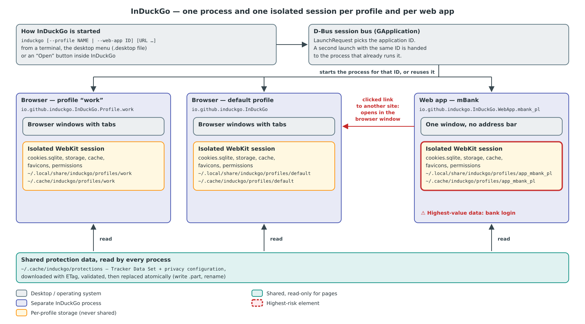

# InDuckGo Architecture

This document explains how InDuckGo is built and why it is built that way. It is written for a reader who
knows some programming but has never worked on a web browser. Every term that is not common knowledge is
defined in [Vocabulary](#2-vocabulary).

## 1. The problem

Most websites load code from companies whose business is following people from site to site: analytics,
advertising and "social" widgets. On Linux, the browsers that block this well are Chromium-based (Brave)
or Firefox-based, and both accept extensions, which are themselves a way to read every page you visit.

DuckDuckGo publishes its tracker protections as open source for its macOS browser: the list of trackers,
the rules that decide what to block, the per-site exceptions that keep sites working, and the scripts that
fight fingerprinting. That browser uses **WebKit**, the same engine Linux has as **WebKitGTK**. InDuckGo
puts those protections into a WebKitGTK browser for Linux, with **no extension support at all**.

Two more goals shape the design:

- **Isolated profiles.** "Work" and "Private" never share a cookie, a login or a cache.
- **Any site as an app.** mBank, Gmail or any other site can be installed as its own desktop application,
  with its icon in the application menu. Each app gets a session of its own, so a phishing link clicked in
  the browser can never reach the bank's login. Brave's web apps (PWAs) share the browser profile's cookies,
  which is weaker.

## 2. Vocabulary

| Term | Meaning |
|---|---|
| WebKitGTK | The Linux edition of WebKit, the engine that downloads, renders and runs web pages. InDuckGo uses its GTK 4 API, `webkitgtk-6.0`. |
| Content blocking rule | A JSON rule WebKit compiles and checks before a request leaves the machine: "if the URL matches this pattern, block it" (or upgrade it to HTTPS). Rules are grouped in *rule lists*. |
| Tracker Data Set (TDS) | DuckDuckGo's list of tracking domains, who owns them and which of their requests are allowed. Licensed CC BY-NC-SA 4.0, so InDuckGo downloads it and never ships it. |
| Privacy configuration | DuckDuckGo's switchboard: which protection is on, and on which sites it must be off because it breaks them (*exceptions*). |
| Content Scope Scripts (C-S-S) | DuckDuckGo's JavaScript that runs inside every page and frame to block fingerprinting and announce GPC. Apache-2.0, version 20.0.0 is vendored in `assets/`. |
| GPC (Global Privacy Control) | A signal telling websites "do not sell or share my data"; legally binding in some US states. |
| ITP (Intelligent Tracking Prevention) | WebKit's built-in limits on cookies and storage of sites classified as trackers. |
| HTTPS upgrade | Loading `https://` when a page asks for `http://`, so nobody on the network can read or change the page. |
| Tracking parameter | A query parameter added to links to follow the click, such as `utm_source`, `fbclid` or `gclid`. |
| Profile | A separate browser identity with its own cookies, storage, cache, history and site permissions. |
| Web app (PWA) | A site installed as a desktop application: its own window, icon and menu entry. |
| Public suffix, registrable domain | `co.uk` and `github.io` are *public suffixes*: anybody can register a name under them. The *registrable domain* is the suffix plus one label (`bbc.co.uk`). Two hosts with the same registrable domain are the *same site*. |
| Application ID | The D-Bus name of a running GTK application, e.g. `io.github.induckgo.InDuckGo`. GTK starts only one process per ID. |
| Desktop entry | A `.desktop` file in `~/.local/share/applications` that puts an application into the desktop's menu. |
| Fire | The button that erases a profile's browsing data in one click. |

## 3. Two crates

The code is split into two Rust crates, and the dependency points one way: `induckgo` → `induckgo-core`.

- **`crates/induckgo-core`** holds the domain logic: building rule lists from the TDS, reading the privacy
  configuration, deciding HTTPS upgrades, finding tracking parameters, parsing the command line, cataloguing
  profiles and web apps, choosing icons, writing desktop entries and naming downloads. It knows nothing about
  GTK or WebKit, so every rule is checked by fast unit tests (`cargo test -p induckgo-core`).
- **`crates/induckgo`** is the GTK 4 + libadwaita application. Its types are adapters: they take a decision
  from the core and carry it out through WebKitGTK, libsoup (HTTP) or GIO (files, processes).

The engineering rules for both crates (Object Oriented Programming First, OO Given/When/Then tests, one
`use` per item) are in [engineering-rules.md](../engineering-rules.md).

## 4. Processes and isolation

Every profile and every installed web app runs as **its own process with its own application ID**:

| What runs | Application ID | Profile directory |
|---|---|---|
| Browser, default profile | `io.github.induckgo.InDuckGo` | `profiles/default` |
| Browser, profile "work" | `io.github.induckgo.InDuckGo.Profile.work` | `profiles/work` |
| Web app "mBank" | `io.github.induckgo.InDuckGo.WebApp.mbank_pl` | `profiles/app_mbank_pl` |

`LaunchRequest` (core) turns the command line `induckgo [--profile NAME | --web-app ID] [URL …]` into one of
these IDs. GTK then asks D-Bus whether that ID already runs: if it does, the new command line is handed over
to the running process (which opens the URL in a window) and the new process exits.

Each process owns exactly one WebKit *network session* stored in the profile's directories
(`~/.local/share/induckgo/profiles/<id>` and `~/.cache/induckgo/profiles/<id>`). It holds the cookie
database, local storage, IndexedDB, cache, favicons and HSTS records. Third-party cookies are refused and ITP
is on. Nothing in this session is ever visible to another profile or app.

**Why one process per profile, not several sessions in one process?** An operating-system process boundary is
the strongest separation Linux offers without containers: a crash, a memory leak or a WebKit bug in the
bank app cannot touch the browser. The desktop also sees each app as a separate application (its own dock
icon, window grouping through `StartupWMClass`), which is what "install as app" promises.

The only shared data is the **protection feed** in `~/.cache/induckgo/protections`: the TDS and the privacy
configuration. Every process reads it. A download replaces a file atomically (write `name.part`, then
rename), so a process never reads half a file.

Before deleting a profile or uninstalling an app, InDuckGo asks D-Bus whether its application ID is still
running (`RunningInstances`) and refuses to delete data that a live process uses.

## 5. From DuckDuckGo data to protected pages

### 5.1 Downloading the data

`ProtectionFeed` downloads `macos-tds.json` and `macos-config.json` from `staticcdn.duckduckgo.com` through
`HttpClient` (libsoup, the HTTP library WebKitGTK itself uses). The network is treated as hostile:

- the request carries no cookies, has a 30-second timeout and stops reading after 32 MiB;
- a reply replaces the cached copy only if it is valid JSON with the expected top-level key (`trackers`,
  `features`);
- refreshes send the stored `ETag`, so an unchanged file costs one tiny request; they run every 12 hours,
  and every 30 seconds while a profile has no protection data at all.

Pages do not load until protections are active (`ProfileSession::when_protected`), so the first page of a
new profile is never loaded unprotected.

### 5.2 Three rule lists

WebKit's `ignore-previous-rules` action (an exception) only cancels rules *of its own list*. InDuckGo
therefore builds three separate lists, so the exceptions of one feature cannot disable another feature:

1. **`trackers`** — `ContentBlockerRulesBuilder`, a port of DuckDuckGo's `TrackerRadarKit`, blocks
   third-party requests to tracking domains, honouring the TDS allow-rules, the configuration's
   `contentBlocking` exceptions, the tracker allowlist, and the sites the user switched protection off for
   (shield button).
2. **`https`** — `HttpsUpgradePolicy` emits one `make-https` rule for every `http://` URL, followed by
   exceptions for IP addresses, single-label and local names (`localhost`, `.local`, `.lan`, `.internal`,
   `.home.arpa`), the configuration's `https` exceptions and hosts whose upgrade failed before. Every
   exemption pattern ends at the host and an optional port, so user info cannot pose as an exempt host:
   `http://localhost:1@example.com/` goes to `example.com` and is upgraded.
3. **`links`** — `TrackingParameterRemover` emits one rule per tracking parameter that blocks a *top-frame
   document* navigation carrying it, except on the sites the configuration exempts.

`PageProtections` compiles each list with WebKit's `UserContentFilterStore`. Compiling the tracker list takes
about a second, so the compiled result is kept on disk next to a fingerprint (hash) of the source; an
unchanged list is loaded instead of compiled.

Even an unchanged tracker list costs something: building its 7,000 rules and serializing them (4.7 MB of
JSON) to compute the fingerprint takes 0.1–0.2 s of processor time, more on a busy machine. That work runs
on a worker thread (`gio::spawn_blocking`), and a start does not wait for it: like DuckDuckGo's macOS app,
the session first activates the tracker list compiled last time, so pages load at once, and swaps in the new
list when it is ready and differs. The `https` and `links` lists are always built fresh before the first
page — they take well under a millisecond, and a stored `https` list could still exempt hosts the user
allowed to load insecurely in an earlier session. Only the very first start, with nothing compiled yet, waits
for the whole compilation.

### 5.3 Reacting to blocked and failed loads

The rules act before a request leaves the machine. Two of them need help from the page afterwards
(`PageView`):

- **Tracking links.** When the `links` list blocks a navigation, WebKit reports a failed load with a policy
  error. `PageView` then loads the same address with the tracking parameters removed. A guard remembers the
  last cleaned address, so a disagreement between rule and cleaner can never cause a loop.
- **Sites without HTTPS.** When an upgraded load fails, a banner says "*host* does not offer a secure
  connection" with a **Load Insecure Page** button. Only after that click is the host added to the profile's
  failed hosts, the `https` list rebuilt and `http://` loaded. Falling back silently would let an attacker on
  the network force any site down to plain HTTP by breaking its HTTPS.

**Error pages.** Every other failure gets an InDuckGo error page instead of WebKit's built-in one, which is a
bare heading on white. WebKit, libsoup and GLib report failures as error codes from several domains: the
resolver, I/O, TLS, and WebKit's own network and policy errors. `ErrorPageView` (app) turns these codes into a
few causes a person can act on (`FailureCause` in core):

- offline;
- host not found;
- connection refused, timed out or interrupted;
- restricted port;
- untrusted certificate, with each reason;
- page crashed or out of memory;
- an HTTP error status with an empty body;
- file not found.

The page names the problem in one heading, says which site it concerns and lists what to check. It offers
only actions that help: Try Again or Reload, Search DuckDuckGo for a host that does not exist, and Go to Home
Page for an empty 404. It is drawn in the browser's current light or dark style with the desktop's accent
colour. The page is loaded as WebKit's *alternate HTML* for the failed address, so the address bar, Reload and
Back behave as for the page that failed.

Four details matter:

- An error status with `Content-Length: 0` is stopped at the response policy. The load then fails and its
  error page takes the history entry, like any other failed load. Shown after the empty page, it would add a
  second entry, and Back would return to the empty page and explain it again, forever.
- Certificate failures arrive through `load-failed-with-tls-errors` with every reason GLib found. The page
  lists them all. There is no "proceed anyway": WebKit never loads such a page, and offering a bypass would
  train users to click through the warning an attacker relies on.
- A connection to a server that never answers is cancelled by libsoup (`G_IO_ERROR_CANCELLED`), not timed out.
  It is therefore explained as a time-out, while a load the user stopped (`WEBKIT_NETWORK_ERROR_CANCELLED`)
  shows nothing.
- The address bar shows no padlock and no install button over an error page, since the page proves nothing
  about the connection. Plain HTTP keeps its warning: the page runs in the site's origin, so the site's other
  windows can still rewrite it.

The page runs in the failed site's origin, so it must not be able to harm anyone. Everything taken from the
failure is HTML-escaped: the address, the host and GLib's message. The template is filled in one pass, so a
value containing `{{…}}` is never expanded. A Content Security Policy (`default-src 'none'`) forbids scripts,
forms and every remote load. Retry links are only emitted for `http`, `https` and `file` addresses.

### 5.4 Content Scope Scripts, GPC and cookies

`ContentScopeScript` fills the C-S-S template with the privacy configuration, the user's unprotected sites
and the preferences (GPC on, a random session key and message secret per process, the UI language). It runs
at document start in every frame, in the page's own JavaScript world, as DuckDuckGo's macOS app does.

Because every frame parses the embedded configuration again, `ContentScopeScript` embeds only the features
the bundled `apple` build runs (`platformSupport.apple` plus their `featureConfigDependencies`). The bundle
itself discards all other features first thing (`pruneConfigFeatures`), so the result is identical, but each
frame now reads about 165 KB of configuration instead of 840 KB (`autoconsent` alone is 520 KB) and the script
shrinks from 1.36 MB to 0.67 MB. A test reads that feature set out of the vendored bundle, so updating C-S-S
cannot silently drop a feature. Its messages arrive at the `contentScopeScripts` handler, which answers notifications with `{}` and requests
with an error object, since InDuckGo implements none of the native features they ask for.

### 5.5 Fire

The Fire button (in each window's header) closes the profile's other windows and erases all of the
profile's website data — cookies, storage, cache, favicons, the zoom given to sites — except the **HSTS** records: those remember
which sites demand HTTPS, and forgetting them would only weaken the next visit. The current window then
starts over with an empty tab.

## 6. Web apps

**Installing.** "Install Site as App" (the button at the right end of the address bar on every web page, or
the window menu) reads the page's title, manifest link and icon links with a script
running in an *isolated JavaScript world*, which the page itself cannot see or tamper with. The manifest and
icons are downloaded without cookies, with size limits (512 KiB manifest, 2 MiB icon). Only PNG icons are
decoded, and only after `PngHeader` confirmed sane dimensions (at most 2048 px per side), which stops
"decompression bombs". The chosen icon is re-encoded as PNG and saved. If no icon downloads, the favicon
WebKit already decoded is used. The result is a catalog entry, an icon and a desktop entry whose `Exec=` line
runs `induckgo --web-app <id>`.

Once installed, the app starts and the browser hands the site over to it: every browser window of the profile
closes the tab the install started from and every tab showing a page of the app (`InstalledWebApp::is_own_page`:
the same origin, meaning scheme, host and port, as the app's start address). A window left without tabs closes.
The test is deliberately narrower than the app's site: a Gmail app owns `mail.google.com`, so a Google Docs or Google
Calendar tab of the same site stays in the browser. Nothing closes if the app could not be started; the toast then
offers to open it.

**Navigating.** `WebAppNavigationPolicy` (core) decides where a navigation inside the app may go:

- a **link the user clicked** to another *site* (registrable domain) opens in the regular browser, so mail
  links and ads never run inside the bank's session;
- **redirects and script navigations** stay, because sign-in (Gmail via `accounts.google.com`) and card
  payments (3-D Secure pages) hop across sites;
- **pop-ups** opened by the app (OAuth, payment confirmation) open in a small window of the same app. They
  share the app's session, so they get the same gate, measured against the site the pop-up was opened for
  (links inside a 3-D Secure page keep working, a clicked link to a third site opens in the browser), and
  the same site indicator in their header.

Handing a page to the browser closes the window it *moved out of*, and only that one. **Open Page in
Browser** moves the app's current page, so the app window closes. A pop-up whose own page goes to the browser
closes as well, since it would only keep showing the page it left. The app window stays when a link in it
opens in the browser: the app is still on its page (a mailbox must survive clicking a link in a message), and
so does a pop-up whose link asked for a *new* window (`target=_blank`), because the pop-up's page — a payment
confirmation, say — is still needed. A window closes only after the browser was started.

Because a redirect may leave the app's site, the window's subtitle always shows the host of the page on
screen. When that page belongs to another site, the subtitle turns to the warning colour and gets an
explanatory tooltip. A bank app therefore cannot show a foreign page under the bank's name unnoticed.

The "same site" test uses the public suffix list of libsoup, the same one WebKit uses for cookies, so the
app agrees with WebKit about what a site is. Only `soup::tld_domain_is_public_suffix` is called. The
`soup::tld_get_base_domain` binding of the `soup3` crate (0.9) reads its result through a pointer into a
temporary string that has already been freed, and it crashed web apps on their first navigation.

## 7. Downloads, permissions and other applications

- **Downloads** are saved in the XDG Downloads folder under a cleaned name (`DownloadFileName`: no path
  separators, no control characters, no leading dots, at most 255 bytes, `name (2).ext` instead of
  overwriting). They are never opened automatically; the toast offers "Show in Folder".
- **Permissions** (location, notifications, clipboard, camera, microphone, screen sharing, storage access)
  are asked every time in a dialog and never granted silently. Pointer lock is allowed; everything else is
  denied.
- **Other schemes** (`mailto:`, `tel:`, `zoommtg:` …) are handed to the desktop only after a real user
  gesture, so a page cannot open applications by itself.
- **Page zoom** steps through DuckDuckGo's sizes (`ZoomLevel`: 50, 75, 85, 100, 115, 125, 150, 175, 200, 250 and
  300 %) with Ctrl `+`/`-`/`0` (also on the keypad), Ctrl with the scroll wheel, or the zoom row of the window
  menu. A size other than 100 % shows as a badge next to the address bar (in a web app, in the header); clicking
  it returns to 100 %. As in DuckDuckGo's macOS browser, the size belongs to the *site* (`SiteZoomLevels`, keyed
  by registrable domain, saved per profile in `site-zoom-levels.json`): every page of the site opens at it, and
  changing it resizes the site's other open tabs at once. WebKit would otherwise carry one tab's zoom over to
  every site the tab visits next. Pages that are not on the web (`file:`, `about:`) open at 100 % and are not
  remembered. Ctrl with the wheel is caught before the page sees it, so a page (a map, say) cannot use that
  gesture for itself; pinching a touchpad still magnifies the page as WebKit does.

## 8. What WebKitGTK can and cannot do (measured on 2.54)

The design above follows from these measurements; each was checked with a running WebKitGTK 2.54 before the
code depended on it.

| Finding | Consequence |
|---|---|
| The `decide-policy` signal cannot tell a main-frame navigation from an iframe one, and shows no `Sec-Fetch-*` headers. | HTTPS upgrades and link cleaning are done with content rules, not in the navigation hook. |
| `make-https` works before the request, in all frames. | It is the HTTPS upgrade mechanism. |
| `redirect` (with `remove-params`) and `modify-headers` compile but have no effect. | Tracking parameters are blocked and the page reloads the cleaned URL; no `Sec-GPC` header can be sent. |
| `block` with `resource-type: document` and `load-context: top-frame` blocks only main-frame navigations, before the request, and reports policy error 104. | This is how `links` rules work. |
| For top-frame loads `unless-domain` is matched against the destination. | Exceptions of `links` rules name destination sites. |
| `ignore-previous-rules` only reaches back within its own rule list. | Three separate lists. |
| Switching off `gtk-enable-animations` inside the application leaves `prefers-reduced-motion` of pages unchanged. | Interface animations (tabs, dialogs, banners, toasts, find bar) are off in every InDuckGo process for a snappier interface, and sites learn nothing new about the user from it. |

## 9. Known limitations

| Limitation | Why | Revisit when |
|---|---|---|
| No `Sec-GPC` HTTP header; GPC is announced only through `navigator.globalPrivacyControl`. | WebKitGTK ignores `modify-headers` rules and offers no request-header hook in the UI process. | WebKitGTK implements `modify-headers`. |
| Tracking parameters are not removed when the page that started the navigation is on an exception list (the macOS app checks the initiator). | Content rules see only the destination. | WebKitGTK exposes the initiator in rules or the navigation hook. |
| A `POST` form whose action URL carries a tracking parameter is retried as a `GET` of the cleaned URL. | The blocked navigation is reloaded with `load_uri`. | Real breakage is reported. |
| Permission answers are not remembered. | Asking every time is the safe default. | Per-profile permission storage is designed. |
| No session restore, bookmarks or history window yet; no automatic cookie-consent handling (DuckDuckGo's autoconsent). | Not yet built. | The next milestone. |
| The user interface is English only. | No translation catalogue yet. | gettext is introduced. |
| Every profile appears as a separate application in the dock. | One application ID per profile process. | Users prefer grouping. |
| A sign-in that starts with a *clicked link* to another site inside a web app opens in the browser. | Clicked off-site links leave the app on purpose (phishing). Most sign-ins redirect or use a pop-up and keep working. | A real app needs it; then an allowlist per app. |

## 10. Trust boundaries

- **Network data** (TDS, configuration, manifests, icons) is size-limited, parsed defensively and validated
  before use. The TDS and configuration are downloaded over HTTPS from DuckDuckGo's CDN only.
- **Web pages** never see the installer's collector script (isolated world). C-S-S messages get only fixed
  answers, and pages cannot open other applications without a user gesture.
- **Files** InDuckGo writes are created with `0600` permissions in `0700` directories. They are written to a
  `.part` file first and renamed into place, so a crash cannot leave a half-written catalog.
- **Desktop entries** are generated by `DesktopEntry`, which escapes names taken from websites. A page title
  can therefore never inject a line such as `Exec=` into the file.
