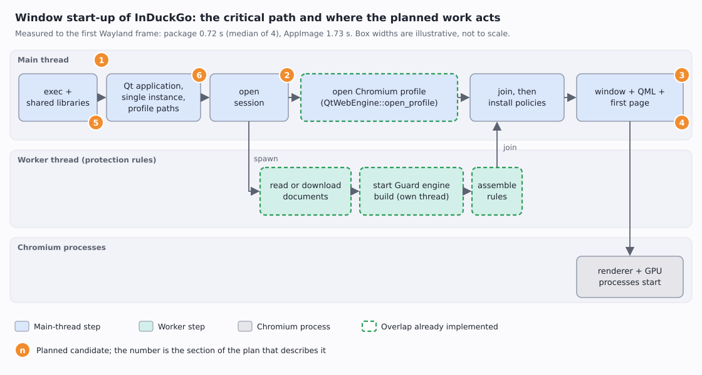

# Window start-up optimizations — plan

**Status:** proposals. Nothing in sections 1–6 is approved or started; implementation begins only after explicit
approval of the section it belongs to. Polish mirror: `docs/pl/plans/2026-11-06-window-startup-optimizations-plan.md`.

## The problem, in plain words

When you click InDuckGo in the application menu, a window must appear. The time between the click and the first
picture on screen is the **time to first frame**. It is the delay a person feels, so it is what this plan tries to
shorten. A browser is slow to start for a structural reason: before it can show a page it must start a
user-interface toolkit (Qt), start Chromium (the web engine, which runs in several processes), and assemble the
privacy rules that every request will be checked against. A page must never load before those rules are in force,
so that last step cannot be skipped, only made faster or overlapped with other work.

## Vocabulary

- **First frame** — the first time the program hands a finished picture of its window to the Wayland compositor.
  Measured as the first `wl_surface#N.attach(wl_buffer#M…)` line in `WAYLAND_DEBUG=client` output.
- **Critical path** — the chain of steps that must finish one after another; only shortening a step *on* this
  path makes the whole start faster. Steps that run alongside it (in the worker thread) cost nothing until they
  become the longest chain.
- **Policies** — the objects that decide, for every request and cookie, whether it may pass (tracker rules,
  Guard's filter lists, the site allow-list). Chromium refuses everything until `QtWebEngine::install_policies`
  has handed them over; that refusal is what makes it safe to do other work meanwhile.
- **Guard engine** — the compiled form of the community filter lists (`SharedGuardEngine`); it is built on its own
  thread, and pages loaded before it is ready are not filtered.
- **AppImage / squashfs / FUSE** — an AppImage is one file holding a compressed read-only file system (squashfs).
  Starting it mounts that file system through FUSE (a user-space file-system driver) and decompresses the
  program's files on demand. A distribution package has none of that: its files are plain files on disk.
- **Cold page cache** — the operating system keeps recently read file contents in memory. A freshly mounted
  AppImage starts with nothing cached, so every launch pays the reading and decompression again.
- **Renderer and GPU process** — Chromium runs web content and graphics in separate processes, started roughly
  when the first web view is created (section 1 should confirm the exact moment).

## Baseline (measured 2026-11-06, KDE Plasma on Wayland, NVMe)

Time to first frame, interleaved runs, each with its own `XDG_*` directories and a copy of the protection cache
(so the first-start download is not counted):

| Build | Runs | Median | Range |
|---|---|---|---|
| Arch package (`/usr/bin/induckgo`, built with `target-cpu=native` and the Cargo profile's `lto = "fat"`) | 4 | 0.72 s | 0.55–0.89 s |
| AppImage 1.2.3 from `dist/` | 4 | 1.73 s | 1.23–2.12 s |

Earlier the same day, with another set of runs: package 0.61 s, AppImage 1.47 s, and the *same files extracted to
a directory* 0.65 s. An empty Qt Quick window opens in 176–275 ms (`docs/en/reports/performance-analysis.md` §4.2,
measured for the migration decision), so about 0.45 s of the package's start is InDuckGo's own work or Chromium's.
**Not measured yet:** the start through KDE's launcher, a second launch that only forwards to the running
instance, and where inside the 0.72 s the time goes (section 1).

## Already done

- **Rules and Chromium's profile overlap** (commit `4fee5c9`). The rules are assembled on a worker thread while
  the main thread opens Chromium's profile; the window opens only after both finish. The cached documents are
  read once instead of twice.
- **Guard's engine is built after the first-start download.** The overlap first built it from the cache before
  the worker had downloaded anything, so a first start would have run with empty Guard lists until the next check
  six hours later. `ProtectionUpdates::starting_protection` now builds it after the download; two scenario tests
  in `crates/induckgo-qt/tests/protection_updates.rs` fail if that order is lost.
- **The menu entry no longer shadows the package** (commit `d92f9a0`). An entry an AppImage wrote earlier took
  precedence over the installed package's entry and kept starting the slower AppImage; the AppImage now
  withdraws its entry when a package owns the entry system-wide.

## Tried and rejected for the AppImage (measured earlier, do not repeat)

| Idea | Result |
|---|---|
| zstd compression level 3 | −10 % start time, +28 MB |
| 1 MiB squashfs blocks | no gain |
| Reading the big libraries in the background from `AppRun` | no gain |
| lz4 compression | the type-2 runtime supports only zlib and zstd |
| Uncompressed squashfs | 0.79 s, but 542 MB |

## 1. Measure first: named milestones

**What.** Record the monotonic time at named points of the start — process start, `QGuiApplication` created,
session opened, worker started and joined, `open_profile` returned, policies installed, window created, first
frame — and print them when an environment variable asks for it. Turn the Wayland-log measurement used for the
baseline into a small committed developer tool next to `induckgo-test-report`, so every later number is
reproducible by anyone.

**Why.** The baseline says the package needs about 0.45 s more than an empty Qt Quick window, but not *where*.
Sections 2–4 are guesses until this breakdown exists, and a guess that shortens a step off the critical path
changes nothing. This section is the gate for 2, 3 and 4: each of them starts only if its step shows up as a
meaningful share of the 0.72 s.

**Done when.** A table in the performance report shows the share of every milestone, from at least ten runs.

## 2. Shorten what runs before the worker starts

**What.** `BrowserApplication::install_policies` calls `open_session` on the main thread before it starts the
worker. `open_session` finishes a burn the Fire button asked for and reads the profile's stored choices; the worker
needs from it only the unprotected-sites list and the session's Guard handle. If section 1 shows `open_session`
as a real cost, split it so the worker can start earlier.

**Risk.** A burn must still finish before anything opens the profile's files; the split must keep that order.

## 3. Create the window while the worker is still assembling

**What.** Today the window is created after the join, so Chromium's renderer and GPU processes (diagram, bottom
lane) start no earlier than that. After `open_profile` the main thread could create the window and the first web view while the
worker finishes, and start the first page load only after `install_policies`. The GTK-era report proposed the
same ordering (`performance-analysis.md` §6, proposal 2, "up to 200 ms to page").

**Limit.** The gain exists only if the worker is still running when `open_profile` returns; section 1 says which
of the two is longer. The profile must be open before the first web view is created, so this overlaps the
worker's tail, not `open_profile` itself.

**Risk, and the rule that stays.** Until policies are installed Chromium refuses every request, so a page loaded
early would show an error page instead of waiting. The load must be *started* after `install_policies`. The Tor
window must still load nothing before Tor is connected, and the first start must still download before any page.

## 4. Check that the QML is compiled ahead of time

**What.** `crates/induckgo-qt/build.rs` lists the QML files of the interface. Qt can compile QML to bytecode or
C++ at build time (`qmlcachegen`) so that start-up does not parse and compile it; whether our build does that is
**unknown today**. Find out (Qt's QML logging categories can show whether compiled units were loaded), and if
they were not, enable it.

**Why it may matter.** The interface has about twenty QML files; parsing them at every start would be pure repeated work.
**Measure with** the milestone "window created" from section 1 before and after.

## 5. AppImage: extract once, run from the cache

**What.** The AppImage costs about one second more than the package (1.73 s against 0.72 s) because every launch
mounts the squashfs through FUSE and decompresses on demand; the same files extracted to a directory start in
0.65 s. `AppRun` could, on first start, copy the tree to `${XDG_CACHE_HOME:-~/.cache}/induckgo/appimage-<build>/`
(extract to a sibling directory, then rename it into place), and on later starts `exec` the cached copy.

**Costs to decide with the owner.** About 540 MB of disk per version (the uncompressed image is 542 MB), a slower
first start by the copy time (not measured), pruning of old versions, and trust: the cached tree is writable by the
person, so the same rule as for the menu entry applies (`AppImageIntegration`: only paths root or the person own
and nobody else can write). Packages remain the fast route on Arch and Fedora; this only helps the AppImage users.

## 6. Measure the launcher path and the second launch

**What.** Time the start through KDE's launcher (`kioclient exec <desktop file>`) against the direct binary, and
the time from a second `induckgo` invocation to the window of the instance that is already running (the
single-instance socket forwards the addresses). Nothing may need optimizing here; until it is measured, the
report would only be guessing.

## Rules every candidate must keep

- No request and no cookie may pass before policies are installed; no page loads unprotected (Chromium's refusal
  until `install_policies` is what makes overlapping safe).
- The first start still downloads the data before the first page, and Guard's engine is built from what was
  downloaded, never from an empty cache.
- The Tor window never loads before Tor is connected and never falls back to a direct connection.
- Chromium's sandbox, site isolation and GPU process stay on: no `--no-sandbox` and no `--single-process` to buy
  speed.
- Every change comes with a scenario test first (Given/When/Then), then the implementation.

## How to measure (the protocol behind the baseline)

1. Give every run its own `XDG_DATA_HOME`, `XDG_CACHE_HOME`, `XDG_CONFIG_HOME` and `XDG_RUNTIME_DIR`, so the
   person's real profiles and the single-instance socket are untouched; point `WAYLAND_DISPLAY` at the absolute
   socket path, because the private runtime directory has none.
2. Copy the real protection cache into the private cache directory, otherwise the first-start download is
   counted.
3. Start with `WAYLAND_DEBUG=client`, record the monotonic time of the process start and of the first
   `wl_surface#N.attach(wl_buffer#M` line. The log format differs between libwayland versions (`#` here, `@` in
   older ones): check one log by eye before trusting a table.
4. Interleave the builds being compared, run each at least four times (ten for a decision), report the median and
   the range, and kill the process group by its PID (never `pkill -f` with a pattern that also appears in the
   command line that runs it).

## Decision log

- The overlap was chosen because the rules and the profile are independent and were the two longest steps of the
  main thread.
- Sections 2–4 are deliberately conditional on section 1: three plausible optimizations, none measured, is how a
  start-up gets complicated without getting faster.
- Section 5 is a trade of disk space for speed that only the owner can make; it is listed so the choice is
  visible, not because it is recommended unconditionally.
