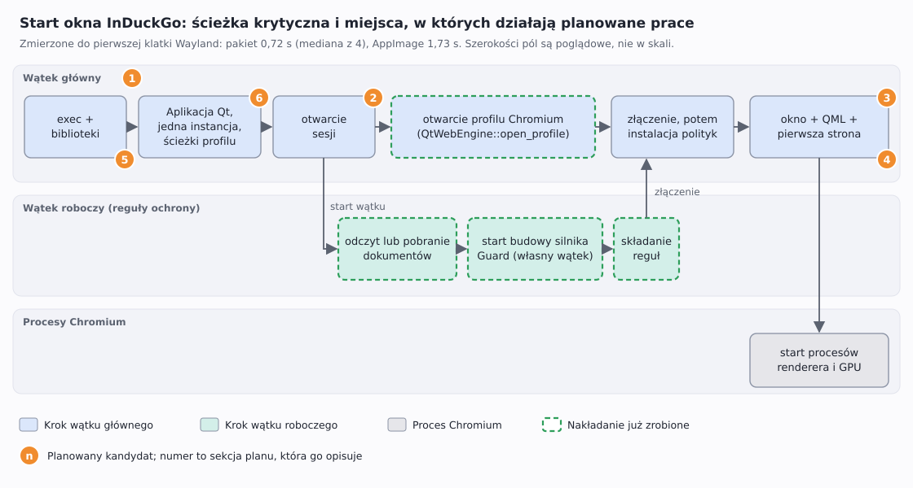

# Optymalizacje startu okna — plan

**Status:** propozycje. Nic z sekcji 1–6 nie jest zatwierdzone ani rozpoczęte; wdrożenie danej sekcji zaczyna się
dopiero po wyraźnej akceptacji. Angielski oryginał: `docs/en/plans/2026-11-06-window-startup-optimizations-plan.md`.

## Problem, prostymi słowami

Po kliknięciu InDuckGo w menu aplikacji musi pojawić się okno. Czas od kliknięcia do pierwszego obrazu na ekranie to
**czas do pierwszej klatki**. To opóźnienie, które człowiek czuje, więc właśnie je ten plan ma skrócić. Przeglądarka
startuje wolno z przyczyn strukturalnych: zanim pokaże stronę, musi uruchomić toolkit interfejsu (Qt), uruchomić
Chromium (silnik www działający w kilku procesach) i złożyć reguły prywatności, według których sprawdzane jest każde
żądanie. Strona nie może się wczytać, zanim te reguły zaczną obowiązywać, więc ostatniego kroku nie da się pominąć,
tylko przyspieszyć lub nałożyć na inną pracę.

## Słownik

- **Pierwsza klatka** — pierwszy moment, w którym program oddaje kompozytorowi Wayland gotowy obraz swojego okna.
  Mierzona jako pierwsza linia `wl_surface#N.attach(wl_buffer#M…)` w wyniku `WAYLAND_DEBUG=client`.
- **Ścieżka krytyczna** — łańcuch kroków, które muszą kończyć się jeden po drugim; cały start przyspiesza tylko
  skrócenie kroku *na tej ścieżce*. Kroki działające obok (w wątku roboczym) nic nie kosztują, dopóki same nie staną
  się najdłuższym łańcuchem.
- **Polityki** — obiekty, które dla każdego żądania i ciasteczka decydują, czy może przejść (reguły trackerów, listy
  filtrów Guard, lista wyjątków witryn). Chromium odrzuca wszystko, dopóki `QtWebEngine::install_policies` ich nie
  przekaże; to odrzucanie sprawia, że w międzyczasie można bezpiecznie robić inne rzeczy.
- **Silnik Guard** — skompilowana postać społecznościowych list filtrów (`SharedGuardEngine`); powstaje we własnym
  wątku, a strony wczytane przed jego gotowością nie są filtrowane.
- **AppImage / squashfs / FUSE** — AppImage to jeden plik z skompresowanym systemem plików tylko do odczytu
  (squashfs). Uruchomienie montuje ten system plików przez FUSE (sterownik systemu plików w przestrzeni użytkownika)
  i rozpakowuje pliki programu na żądanie. Paczka dystrybucji nie ma nic z tego: jej pliki leżą na dysku zwyczajnie.
- **Zimna pamięć podręczna stron** — system operacyjny trzyma w pamięci niedawno czytane zawartości plików. Świeżo
  zamontowany AppImage startuje bez niczego w pamięci, więc każde uruchomienie płaci za odczyt i rozpakowanie od nowa.
- **Proces renderera i GPU** — Chromium wykonuje treść stron i grafikę w osobnych procesach, uruchamianych mniej
  więcej wtedy, gdy powstaje pierwszy widok www (sekcja 1 powinna potwierdzić dokładny moment).

## Stan wyjściowy (zmierzone 2026-11-06, KDE Plasma na Waylandzie, NVMe)

Czas do pierwszej klatki, uruchomienia przeplatane, każde z własnymi katalogami `XDG_*` i kopią pamięci podręcznej
ochrony (żeby nie liczyć pobierania przy pierwszym starcie):

| Wersja | Uruchomień | Mediana | Zakres |
|---|---|---|---|
| Paczka Arch (`/usr/bin/induckgo`, budowana z `target-cpu=native` i `lto = "fat"` z profilu Cargo) | 4 | 0,72 s | 0,55–0,89 s |
| AppImage 1.2.3 z `dist/` | 4 | 1,73 s | 1,23–2,12 s |

Wcześniej tego samego dnia, w innej serii: paczka 0,61 s, AppImage 1,47 s, a *te same pliki rozpakowane do katalogu*
0,65 s. Puste okno Qt Quick otwiera się w 176–275 ms (`docs/pl/reports/performance-analysis.md` §4.2, zmierzone przy
decyzji o migracji), więc około 0,45 s startu paczki to praca InDuckGo lub Chromium.
**Jeszcze nie zmierzono:** startu przez launcher KDE, drugiego uruchomienia, które tylko przekazuje adres do działającej
instancji, ani tego, gdzie w tych 0,72 s ucieka czas (sekcja 1).

## Już zrobione

- **Reguły i profil Chromium nakładają się** (commit `4fee5c9`). Reguły są składane w wątku roboczym, gdy wątek
  główny otwiera profil Chromium; okno otwiera się dopiero po zakończeniu obu. Zapisane dokumenty są czytane raz,
  a nie dwa razy.
- **Silnik Guard powstaje po pobraniu przy pierwszym starcie.** Nakładanie najpierw budowało go z pamięci podręcznej,
  zanim wątek roboczy cokolwiek pobrał, więc pierwszy start działałby z pustymi listami Guard aż do następnego
  sprawdzenia po sześciu godzinach. `ProtectionUpdates::starting_protection` buduje go teraz po pobraniu; dwa testy
  scenariuszowe w `crates/induckgo-qt/tests/protection_updates.rs` zawodzą, jeśli ta kolejność zostanie utracona.
- **Wpis menu nie przesłania już paczki** (commit `d92f9a0`). Wpis zapisany wcześniej przez AppImage miał
  pierwszeństwo przed wpisem zainstalowanej paczki i dalej uruchamiał wolniejszy AppImage; AppImage wycofuje teraz
  swój wpis, gdy paczka ma wpis w całym systemie.

## Sprawdzone i odrzucone dla AppImage (zmierzone wcześniej, nie powtarzać)

| Pomysł | Wynik |
|---|---|
| Kompresja zstd na poziomie 3 | −10 % czasu startu, +28 MB |
| Bloki squashfs 1 MiB | bez zysku |
| Czytanie dużych bibliotek w tle z `AppRun` | bez zysku |
| Kompresja lz4 | runtime typu 2 obsługuje tylko zlib i zstd |
| Squashfs bez kompresji | 0,79 s, ale 542 MB |

## 1. Najpierw zmierzyć: nazwane punkty czasowe

**Co.** Zapisywać monotoniczny czas w nazwanych punktach startu — start procesu, utworzenie `QGuiApplication`,
otwarcie sesji, start i dołączenie wątku roboczego, powrót z `open_profile`, instalacja polityk, utworzenie okna,
pierwsza klatka — i wypisywać je, gdy poprosi o to zmienna środowiskowa. Pomiar z logu Wayland, użyty do stanu
wyjściowego, zamienić w małe, zatwierdzone narzędzie deweloperskie obok `induckgo-test-report`, żeby każdą kolejną
liczbę dało się odtworzyć.

**Dlaczego.** Stan wyjściowy mówi, że paczka potrzebuje około 0,45 s więcej niż puste okno Qt Quick, ale nie *gdzie*.
Sekcje 2–4 są zgadywaniem, dopóki nie ma tego rozkładu, a zgadnięcie kroku poza ścieżką krytyczną niczego nie zmienia.
Ta sekcja jest bramką dla 2, 3 i 4: każda z nich rusza tylko wtedy, gdy jej krok stanowi zauważalną część z 0,72 s.

**Gotowe, gdy.** Tabela w raporcie wydajności pokazuje udział każdego punktu, z co najmniej dziesięciu uruchomień.

## 2. Skrócić to, co działa przed startem wątku roboczego

**Co.** `BrowserApplication::install_policies` wywołuje `open_session` w wątku głównym, zanim uruchomi wątek roboczy.
`open_session` kończy spalenie danych zleconych przyciskiem Fire i czyta zapisane wybory profilu; wątek roboczy
potrzebuje z niej tylko listy witryn bez ochrony i uchwytu Guard sesji. Jeśli sekcja 1 pokaże `open_session` jako
realny koszt, podzielić ją tak, by wątek roboczy mógł ruszyć wcześniej.

**Ryzyko.** Spalenie danych musi nadal kończyć się, zanim cokolwiek otworzy pliki profilu; podział musi zachować tę
kolejność.

## 3. Tworzyć okno, gdy wątek roboczy jeszcze składa reguły

**Co.** Dziś okno powstaje po złączeniu, więc procesy renderera i GPU Chromium (diagram, dolny pas) startują nie
wcześniej niż to. Po `open_profile` wątek główny mógłby tworzyć okno i pierwszy widok www, gdy wątek roboczy kończy,
a wczytanie pierwszej strony zacząć dopiero po `install_policies`. Raport z czasów GTK proponował to samo ułożenie
(`performance-analysis.md` §6, propozycja 2, „do 200 ms do strony”).

**Ograniczenie.** Zysk istnieje tylko wtedy, gdy wątek roboczy jeszcze działa, kiedy wraca `open_profile`; sekcja 1
powie, który z dwóch jest dłuższy. Profil musi być otwarty przed utworzeniem pierwszego widoku www, więc to nakłada
się na ogon wątku roboczego, a nie na samo `open_profile`.

**Ryzyko i reguła, która zostaje.** Dopóki polityki nie są zainstalowane, Chromium odrzuca każde żądanie, więc strona
wczytana za wcześnie pokazałaby stronę błędu zamiast poczekać. Wczytanie trzeba *zacząć* po `install_policies`. Okno
Tor nadal nie może niczego wczytać przed połączeniem z Tor, a pierwszy start nadal musi pobrać dane przed jakąkolwiek
stroną.

## 4. Sprawdzić, czy QML jest kompilowany z wyprzedzeniem

**Co.** `crates/induckgo-qt/build.rs` wylicza pliki QML interfejsu. Qt potrafi skompilować QML do kodu bajtowego lub
C++ podczas budowania (`qmlcachegen`), żeby start nie parsował i nie kompilował go od nowa; czy nasza budowa to robi,
jest dziś **nieznane**. Ustalić (kategorie logowania QML w Qt mogą pokazać, czy wczytano skompilowane jednostki),
a jeśli nie, włączyć.

**Dlaczego może mieć znaczenie.** Interfejs ma około dwudziestu plików QML; parsowanie ich przy każdym starcie byłoby
czystą, powtarzaną pracą. **Mierzyć** punktem „okno utworzone” z sekcji 1 przed zmianą i po niej.

## 5. AppImage: rozpakować raz, uruchamiać z pamięci podręcznej

**Co.** AppImage kosztuje około sekundę więcej niż paczka (1,73 s wobec 0,72 s), bo każde uruchomienie montuje
squashfs przez FUSE i rozpakowuje na żądanie; te same pliki rozpakowane do katalogu startują w 0,65 s. `AppRun`
mógłby przy pierwszym starcie skopiować drzewo do `${XDG_CACHE_HOME:-~/.cache}/induckgo/appimage-<build>/`
(rozpakować do sąsiedniego katalogu, potem zmienić mu nazwę na docelową), a przy kolejnych startach robić `exec`
z kopii.

**Koszty do rozstrzygnięcia z właścicielem.** Około 540 MB dysku na wersję (obraz bez kompresji ma 542 MB), wolniejszy
pierwszy start o czas kopiowania (niezmierzony), sprzątanie starych wersji oraz zaufanie: skopiowane drzewo jest
zapisywalne przez osobę, więc obowiązuje ta sama reguła co dla wpisu menu (`AppImageIntegration`: tylko ścieżki, które
należą do roota lub osoby i do których nikt inny nie może pisać). Paczki pozostają szybką drogą na Archu i Fedorze;
to pomaga tylko użytkownikom AppImage.

## 6. Zmierzyć ścieżkę przez launcher i drugie uruchomienie

**Co.** Zmierzyć start przez launcher KDE (`kioclient exec <plik desktop>`) w porównaniu z bezpośrednią binarką oraz
czas od drugiego wywołania `induckgo` do okna już działającej instancji (gniazdo jednej instancji przekazuje
adresy). Może tu nie być nic do optymalizowania; dopóki nie zmierzono, raport tylko by zgadywał.

## Reguły, które musi zachować każdy kandydat

- Żadne żądanie ani ciasteczko nie przechodzi przed instalacją polityk; żadna strona nie wczytuje się bez ochrony
  (odrzucanie przez Chromium do `install_policies` sprawia, że nakładanie jest bezpieczne).
- Pierwszy start nadal pobiera dane przed pierwszą stroną, a silnik Guard powstaje z tego, co pobrano, nigdy
  z pustej pamięci podręcznej.
- Okno Tor nigdy nie wczytuje się przed połączeniem z Tor i nigdy nie wraca do połączenia bezpośredniego.
- Piaskownica Chromium, izolacja witryn i proces GPU zostają włączone: żadnego `--no-sandbox` ani `--single-process`
  dla szybkości.
- Każda zmiana ma najpierw test scenariuszowy (Given/When/Then), potem implementację.

## Jak mierzyć (protokół za stanem wyjściowym)

1. Każde uruchomienie dostaje własne `XDG_DATA_HOME`, `XDG_CACHE_HOME`, `XDG_CONFIG_HOME` i `XDG_RUNTIME_DIR`, żeby
   prawdziwe profile osoby i gniazdo jednej instancji pozostały nietknięte; `WAYLAND_DISPLAY` ustawić na bezwzględną
   ścieżkę gniazda, bo prywatny katalog uruchomieniowy go nie ma.
2. Skopiować prawdziwą pamięć podręczną ochrony do prywatnego katalogu pamięci podręcznej, inaczej liczy się
   pobieranie przy pierwszym starcie.
3. Uruchamiać z `WAYLAND_DEBUG=client`, zapisać monotoniczny czas startu procesu i pierwszej linii
   `wl_surface#N.attach(wl_buffer#M`. Format logu różni się między wersjami libwayland (tu `#`, w starszych `@`):
   przed zaufaniem tabeli obejrzeć jeden log.
4. Przeplatać porównywane wersje, uruchamiać każdą co najmniej cztery razy (dziesięć przy decyzji), podawać medianę
   i zakres, a proces zabijać po PID grupy (nigdy `pkill -f` ze wzorcem, który występuje też w poleceniu go
   uruchamiającym).

## Dziennik decyzji

- Nakładanie wybrano, bo reguły i profil są niezależne i były dwoma najdłuższymi krokami wątku głównego.
- Sekcje 2–4 są celowo zależne od sekcji 1: trzy prawdopodobne optymalizacje, żadna niezmierzona, to sposób, w jaki
  start robi się bardziej skomplikowany, a nie szybszy.
- Sekcja 5 to wymiana miejsca na dysku za szybkość, którą może zrobić tylko właściciel; jest wypisana, by wybór był
  widoczny, a nie dlatego, że jest bezwarunkowo polecana.
